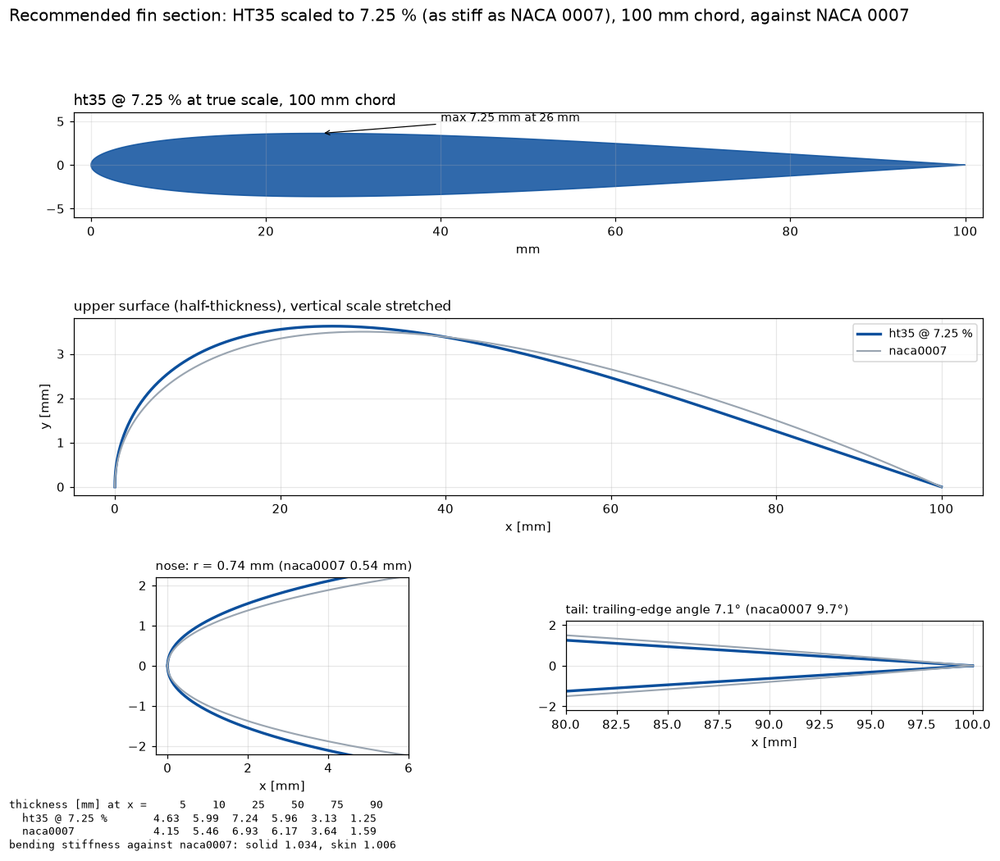
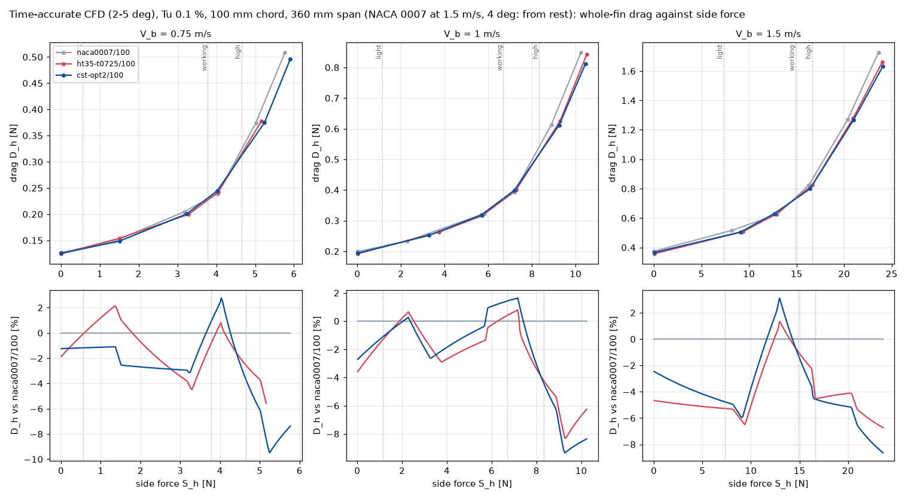
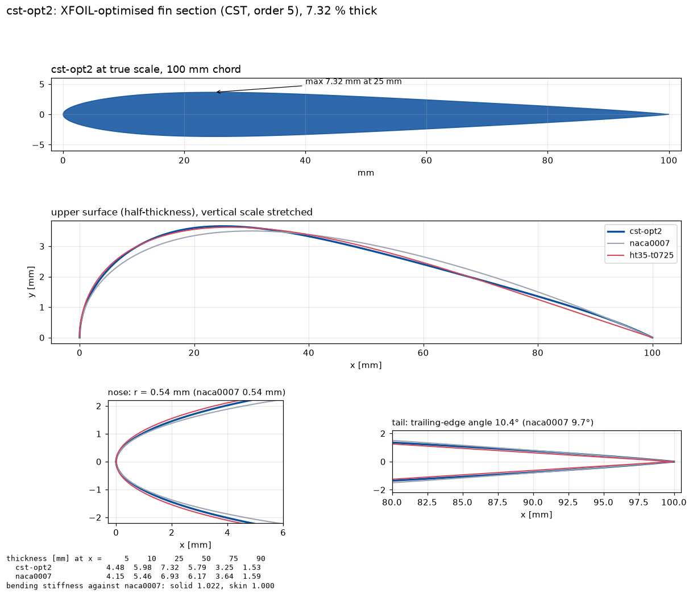

# custom-section: findings log

Can a custom fin section beat NACA 0007 at 100 mm chord, the all-round
recommendation of [fin-profile-selection.md](fin-profile-selection.md)?
This log covers the research: the XFOIL analyses (no CFD cases), the CFD
screen (`custom-section-screen`) and the time-accurate check of the leaders
that follows it. Newest entry first; entries are not rewritten later, except
"Where the research stands", the current summary, which is updated in
place. Results live in `runs/` (not in git), so the numbers that support a
conclusion are copied here.

Symbols follow [docs/nomenclature.md](../../../docs/nomenclature.md) (S_h,
D_h = D_v + D_i, leeway β_Y, section angle α) in entries from the Tu runs
on; the earlier entries say "side force", "drag" and "leeway" in words.

Tools (all in this repository):
* `iomcfd.xfoil`: XFOIL polars (build the binary with
  `tools/build-xfoil.sh`).
* `iomcfd.racetime`: methodology.md steps 1-7, the race-time ranking, as
  code. It reproduces the published Tu 0.1 % table of fin-profile-selection
  run 20261013-200643 to rounding (every load and the worst point).
* `iomcfd.sectiondesign`: section families (NACA modified 4-digit, CST),
  section properties (nose radius, trailing-edge angle, bending stiffness),
  the XFOIL screen, the calibration against CFD, the optimiser, the
  export of sections to `geometry/foils/` for the CFD, and section figures.
* `projects/foil2d/design/loads.csv`: the comparison side forces.
* `figures/`: section figures for this log (committed, unlike `runs/`),
  each with the command that draws it.

## Where the research stands (updated 2026-10-23, with NACA 0007 from rest at 1.5 m/s)

**Answer: yes, a section other than NACA 0007 is better. Recommended: M.
Drela's HT35 scaled to 7.25 % thickness, 100 mm chord**
(`geometry/foils/ht35-t0725.dat`). The recommendation for now (user,
2026-10-23). Website: `site/custom-section/`.
* HT35 is one of Drela's HT3x tail sections for F3B sailplanes (UIUC
  database, "Drela HT35 airfoil"; added there in June 2023).
* It is as stiff in bending as NACA 0007/100.
* Its maximum thickness is further forward (x/c 0.26 against 0.30), its
  nose rounder (0.74 against 0.54 mm radius at 100 mm), and its tail
  straighter (trailing edge 7.1° against 9.7°).

Drawn by `python -m iomcfd.sectiondesign figure "file:ht35.dat@0.0725"
--compare naca0007 --out ...`, from the UIUC coordinates scaled to 7.25 %.
`geometry/foils/ht35-t0725.dat`, the file the CFD meshed, has the same
shape (to 1e-7 c). But it was written at 7 decimals, so a nose radius read
back from it comes out low (0.58 mm; Analysis 3, Learnings). For CAD or a
mould, export at 10 decimals:
`python -m iomcfd.sectiondesign export "file:ht35.dat@0.0725" --names <name>`.

**What it gains over NACA 0007/100** (2D CFD, race-time metric of
methodology.md; slope ×1 / ×2):

| water | gain | source | confidence |
|---|---|---|---|
| calm, Tu 0.1 % | 0.66 / 0.38 % of race time, about 2.8 / 1.6 boat lengths (**estimate**) | time-accurate at 2-5°, NACA 0007 at 1.5 m/s from rest | medium |
| moderate, Tu 1 % | 0.34 / 0.20 % | steady (steady flow at this Tu) | medium |
| rough, Tu 2 % | break-even (−0.01 / −0.00 %) | steady | medium |

* At Tu 0.1 % it is ahead at every speed (0.41 % at 0.75 m/s, 0.71 % at
  1 m/s, 0.86 % at 1.5 m/s) and every load.
* **Revised 2026-10-23.** The first time-accurate check had 0.82 / 0.44 %
  and 1.34 % at 1.5 m/s. There NACA 0007/100, started from its steady
  solution, settled into a high-drag leading-edge bubble at 4°. Started
  from rest, it sheds with 18 % less drag (main's transient-check.md), and
  the figures above use that point. Analysis 2026-10-23.

**The plan** (agreed with the user, 2026-10-17), all done:
1. Screen published sections. XFOIL, then CFD run 20261018-043724.
2. Calibrate XFOIL against the CFD. On 0.5° steps it ranks sections as
   the CFD does at Tu 0.1 % (Spearman 0.86-1.00 for 7-9 sections). It
   flatters steep trailing-edge closures (cst-opt1), and at Tu 1 % sharp
   noses (NACA 0006).
3. Optimise. cst-opt2 (figure in Analysis 3) is second in time-accurate
   CFD: −0.70 / −0.37 %, behind HT35.
4. Check the leaders time-accurately and at Tu 1-2 %. Entries above.

The taper and 3D are out of scope here: they are the `keel3d` project's
(user, 2026-10-18).

**Rejected, in XFOIL and CFD alike:**
* a rounder nose on NACA 0007 (0007-73);
* laminar 6-series sections (NACA 64-007);
* maximum thickness further aft;
* a steep "boat-tail" trailing edge (cst-opt1);
* SD8020 is third in the steady screen and was not checked further.

**What would firm it up** (proposed):
* Whether the custom sections also have a second flow at 1.5 m/s, or NACA
  0007 at 5° (Analysis 2026-10-23, conclusion 3).
* A 3D check in `keel3d`.
* A mould-tolerance check.
* Eventually, a tow or two-boat test.

**Also found:**
* **The 2° angle grid of every fin-profile-selection ranking moves
  candidates by up to 0.5 % of race time** (screen, conclusion 6).
* **Cloud jobs now survive Spot preemption** (checkpoints,
  docs/cloud-gcp.md).

**How much a better section is worth** (estimate, from methodology.md at
1 m/s): 1 % less section drag on both legs saves about 0.17 % of race time
(0.08 % with the slope doubled), roughly 0.7 boat lengths.

## Analysis 2026-10-23: NACA 0007/100 from rest at 1.5 m/s (no new cases)

**Setup.** Main's transient-check run 20261018-231921 (findings
transient-check.md, 2026-10-22) ran NACA 0007/100 at 4° and 1.5 m/s from
rest. Run 20261017-193613 did the same at max_co 10. Here that max_co 10
point (Cl 0.4024, Cd 0.01238) replaces the one the time-accurate check
used. That point started from the steady solution and settled into the
leading-edge-bubble flow (Cd 0.0151). Everything else is as in the
time-accurate check.

### Conclusions

1. **Started from rest, NACA 0007/100 at 4° and 1.5 m/s sheds, with 18 %
   less drag than the bubble flow.** The model has two flows at that point,
   and which one it finds depends on the start (transient-check.md). This
   **revises conclusion 3 of the time-accurate check**: the leading-edge
   bubble is not a property of NACA 0007 there, only of a start from the
   steady solution. The custom sections shed from the same start, so the
   fair comparison is shedding against shedding.
2. **HT35 at 7.25 % still beats NACA 0007/100 at every speed and load, by
   less.** Race-time gain, % (slope ×1 / ×2):

   | NACA 0007 at 4°, 1.5 m/s | overall | 0.75 m/s | 1.0 m/s | 1.5 m/s |
   |---|---|---|---|---|
   | from the steady solution (bubble), as before | −0.82 / −0.44 | −0.41 | −0.71 | −1.34 |
   | **from rest (shedding)** | **−0.66 / −0.38** | −0.41 | −0.71 | **−0.86** |

   cst-opt2: −0.54 / −0.30 (1.5 m/s: −0.66). Confidence: medium.
3. **Other NACA 0007 points may have the same two flows.** At 5° and
   1.5 m/s its time-accurate flow is steady (lift oscillation 0.02 %),
   while HT35's sheds (2.2 %). Their drag differs by only 2.7 % there, so
   the ranking can't move much from it. Not checked.

### Decisions

* **The recommendation stands: HT35 at 7.25 %.** Its gain is now quoted
  with NACA 0007's from-rest point: 0.66 / 0.38 % of race time at Tu 0.1 %,
  about 2.8 / 1.6 boat lengths (**estimate**).

## Time-accurate check: custom-section-transient, -transient-opt2, -transient-15 and -transient-rerun (2026-10-18 to 2026-10-21, images 6d541d0 and 9b8cbb8, GCP, 36 cases + 7 again + 3 reruns)

**Setup.** NACA 0007, HT35 at 7.25 % and cst-opt2, all at 100 mm and equal
bending stiffness.
* At Tu 0.1 %, time-accurate (pimpleFoam) at 2, 3, 4 and 5°, at 0.75, 1.0
  and 1.5 m/s: the angles the three loads need at 100 mm.
* 0° and 6° stay steady. The 0° drag oscillates under 0.01 %; the flow at
  6° was steady in transient-check.
* Settings of transient-check run 20261017-000816:
  * 20 flow-throughs, averaged over 12-20;
  * max_co 10;
  * medium mesh;
  * each case started from its steady solution of the screen or the optima
    run (`start_from`).

The runs:
* `custom-section-transient`, run 20261018-104120: NACA 0007 and HT35, 24
  cases. 16 finished. One blew up (below). The seven at 1.5 m/s were lost
  to Spot preemption twice (about 25 h) and cancelled.
* `custom-section-transient-opt2`, run 20261018-161314: cst-opt2, 12 cases.
  11 finished, one blew up.
* `custom-section-transient-15`, run 20261019-164044: the seven 1.5 m/s
  cases again, on image 9b8cbb8 with checkpoints (docs/cloud-gcp.md). Two
  preemptions, at 19:50 and about 22:30 UTC: all six running cases resumed
  from their checkpoints within 40 s each time. One blew up.
* `custom-section-transient-rerun`, runs 20261018-195326, 20261019-214537 and
  20261019-203535: the three cases that blew up, again at max_co 5.
  * NACA 0007 at 3°, 1 m/s: 11.7 h.
  * cst-opt2 at 5°, 0.75 m/s: 20.6 h. Its first try (run 20261019-020241,
    no checkpoints) was preempted after 17 h and cancelled.
  * HT35 at 3°, 1.5 m/s: three preemptions, each resumed from a checkpoint.

How the ranking was computed: `python -m iomcfd.sectiondesign cfd`, the steady
screen and optima runs with the time-accurate points replacing theirs
(`--replace`, all six results.csv), at the loads of `design/loads.csv`. Every
2-5° point of the three sections is time-accurate. The polars are in
`runs/section-design/final-polars-tu0.1.csv` (not in git).

### Conclusions

1. **HT35 at 7.25 % beats NACA 0007/100 at every speed and every load in
   time-accurate CFD: 0.82 % of race time with the estimated resistance
   slope, 0.44 % with it doubled.** cst-opt2 is second. Race-time gain
   against 0007/100, %:

   | section | ×1 | ×2 | 0.75 m/s | 1.0 m/s | 1.5 m/s | worst load |
   |---|---|---|---|---|---|---|
   | **HT35 @7.25 %** | **−0.82** | **−0.44** | −0.41 | −0.71 | −1.34 | −0.21 |
   | cst-opt2 | −0.70 | −0.37 | −0.38 | −0.56 | −1.15 | +0.03 |
   | NACA 0007 | 0 | 0 | 0 | 0 | 0 | 0 |

   ("worst load" is ×1, the least favourable of the nine speed-load
   points.) In boat lengths, about 3.4 / 1.8 per race (**estimate**: 4.2 per
   1 %). Confidence: medium.
   * Every number is time-accurate where the flow sheds.
   * But it is 2D, at one Tu, and with estimated race-time inputs.

   

   Drawn by `python -m iomcfd.sectiondesign cfd <screen and optima
   results.csv> --replace <the six time-accurate results.csv>
   <transient-check run 20261017-193613's results.csv> --only
   file:ht35-t0725.dat/100 file:cst-opt2.dat/100 --figure ...`. Since
   2026-10-23 the figure shows NACA 0007 at 4° and 1.5 m/s from rest
   (Analysis 2026-10-23); the table above has the steady-start point.
2. **The time-accurate points move the gain from 0.75-1 m/s to 1.5 m/s.**
   HT35 at 7.25 %, slope ×1:

   | | 0.75 m/s | 1.0 m/s | 1.5 m/s | mean |
   |---|---|---|---|---|
   | steady | −0.87 | −0.86 | −0.35 | −0.69 |
   | time-accurate | −0.41 | −0.71 | −1.34 | −0.82 |

   At 0.75 and 1 m/s the steady solver overstated it, as feared (screen,
   conclusion 2). At 1.5 m/s it understated it (conclusion 3). The mean
   barely moves.
3. **At 1.5 m/s and 4°, NACA 0007/100 again settles into a leading-edge
   bubble with high drag. The custom sections don't.**

   | | NACA 0007 | HT35 @7.25 % | cst-opt2 |
   |---|---|---|---|
   | C_l | 0.429 | 0.411 | 0.405 |
   | C_d | 0.0151 | 0.0120 | 0.0117 |
   | lift oscillation | 0.3 % | 8.7 % | 8.9 % |

   * NACA 0007's flow there is steady (lift oscillation 0.3 %).
   * The same state and drag as transient-check run 20261017-000816 (C_d
     0.0152), started there from a different steady solution.
   * The custom sections shed instead and have 21-23 % less drag at that
     angle.

   At the loads at 1.5 m/s the custom sections have 5-10 % less upwind
   drag, and HT35 4.6 % less at 0°. That is where most of their advantage
   comes from. Confidence: medium. Both NACA runs started from a steady
   solution, and the from-rest check (transient-check run 20261018-231921)
   hasn't finished.
4. **cst-opt2, the XFOIL optimum, doesn't beat HT35 in time-accurate CFD.**
   * It is 0.12 / 0.07 % behind on average.
   * It is behind at 1 and 1.5 m/s and level at 0.75 m/s (−0.38 against
     −0.41).
   * Its working-load drag at 0.75 and 1 m/s is 0.9-1.4 % above NACA
     0007's; HT35's is within 0.4 % or below.

   The optimiser's objective (XFOIL, worst variant) and the CFD differ in
   detail. The steady CFD had the two tied (optima, conclusion 1).
5. **The time-accurate polars at the loads** (C_l, C_d; 1 m/s):

   | aoa | NACA 0007 | HT35 @7.25 % | cst-opt2 |
   |---|---|---|---|
   | 2° | 0.127, 0.0122 | 0.209, 0.0125 | 0.182, 0.0124 |
   | 3° | 0.324, 0.0128 | 0.318, 0.0126 | 0.316, 0.0128 |
   | 4° | 0.400, 0.0140 | 0.405, 0.0142 | 0.400, 0.0143 |
   | 5° | 0.494, 0.0221 | 0.516, 0.0216 | 0.514, 0.0210 |

   * **At 2°** the custom sections make 43-65 % more lift: no low-Reynolds
     lift loss near 0°. So less leeway at the light load (0.61° against
     1.01° for HT35 at 1 m/s). Their 2° cases oscillate about 20 % and
     drift, so this is the least certain part.
   * **At 5°** they make 4 % more lift with 2-5 % less drag.

### Decisions

* **Recommended section: HT35 scaled to 7.25 % thickness, 100 mm chord**
  (`geometry/foils/ht35-t0725.dat`). Proposed, not yet agreed with the user.
  * It is as stiff in bending as NACA 0007/100.
  * The gain over 0007/100 (Tu 0.1 %): 0.4-0.8 % of race time.
  * At Tu 1 %: 0.2-0.3 % (steady, reliable there). At Tu 2 %: break-even.
* **cst-opt2 is kept as the alternative,** not recommended: it is behind
  HT35 in time-accurate CFD and is not a published section.
* **This revises the selection's recommendation** (NACA 0007/100,
  fin-profile-selection.md): a custom section beats it at every speed
  tested. That log isn't edited here; its summary should point here.

### Assumptions

* As the earlier entries: 2D URANS represents the shedding (**not
  validated**); the race-time inputs (**not verified**); steady 0° and 6°
  points can be mixed with time-accurate ones (**not verified**).
* That max_co 5 (three reruns) and max_co 10 give the same time averages.
  **Not checked** at these points; transient-check found the time step
  mattered little where both were run.
* That a resumed case is equivalent to an uninterrupted one. Checked on one
  short case (docs/cloud-gcp.md); the checkpointed runs also write every
  flow-through, which nudges the adaptive time step (round-off level).

### Compromises

* Tu 0.1 % only for the time-accurate check. At Tu 1-2 % the flow is steady
  and the steady runs stand.
* 2D only. The taper and 3D effects are the `keel3d` project's.
* The 2° cases of the custom sections haven't settled.

### Learnings

* **Spot preemption decides what long cases cost.** us-central1 C3D Spot
  VMs were preempted after 2-16 h of running over these three days.
  * Before checkpoints, the seven 1.5 m/s cases lost about 25 h each and
    never finished.
  * With checkpoints, the same cases lost under an hour per preemption,
    and HT35 at 3° got through three preemptions.
* **max_co 10 blew up in 3 of 43 time-accurate attempts** (36 distinct
  cases): a time step collapsing in one step, Courant number 3e4-1.4e8, on
  all three sections.
  max_co 5 ran all three cleanly at about twice the cost.
* **The runner's divergence stop** (main's monitor.py) caught the 1.5 m/s
  blow-up within minutes and reported it failed with the reason, instead of
  running on.
* **A bug in `cfd_table` (now fixed):** a replacement point was dropped when
  the steady case it replaced had failed. For half a day that made HT35 look
  8.8 % worse at the 1 m/s working load. The published numbers here use the
  fix (a test covers it).
* **XFOIL input precision:** with 10-digit coordinates, Analysis 1's 1 m/s
  calibration gives Spearman 0.86 / 0.96 (published 0.89 / 0.96), with the
  same leader.

### Open questions and next steps

Proposed, not agreed:
* **NACA 0007/100 from rest at 1.5 m/s** (transient-check run
  20261018-231921, running): does the leading-edge bubble come back without
  a steady start? Conclusion 3 rests on it.
* **Re-rank the NACA finalists with 3° and 5° points** (screen,
  conclusion 6). The custom-section verdict doesn't depend on it, but the
  selection's order among NACA sections may.
* **3D:** HT35 at 7.25 % on the tapered fin of `keel3d`, against NACA 0007
  on the same planform.
* **The trip-strip study** (on hold until a section was recommended).
* **A mould-tolerance check** before cutting a fin from
  `ht35-t0725.dat`. XFOIL suggests 0.05 mm errors cost little (Analysis 3,
  for cst-opt1).

## Runs 20261018-104350 and 20261018-155808: custom-section-tu and custom-section-tu-opt2 (2026-10-18, git 6d541d0-dirty, image 6d541d0, GCP, 72 + 36 cases)

**Setup.** NACA 0007, HT35 at 7.25 % and cst-opt2, all at 100 mm and equal
bending stiffness, at Tu 1 % and 2 %. Settings as the Tu 0.1 % screen and
optima runs: 0.75, 1.0 and 1.5 m/s × 0, 2, 3, 4, 5 and 6°, kOmegaSSTLM,
steady, medium mesh. cst-opt2 is a separate run (added later at the user's
request), with the same image and settings.

Why: the pond's Tu is unknown, and XFOIL had the custom family's gain
turning into a loss at Tu 2 % (Analysis 3, conclusion 4).

**Outcome.** 107 ok, 1 not converged, none failed.

Symbols from here on follow [docs/nomenclature.md](../../../docs/nomenclature.md):
* the fin's side force S_h and drag D_h;
* leeway β_Y. At equal span and S_h, a difference in section angle α is a
  difference in β_Y.

### Conclusions

1. **The custom sections' gain halves at Tu 1 % and is gone at Tu 2 %.
   Neither is meaningfully worse than NACA 0007 there.** Race-time gain
   against 0007/100, % (slope ×1 / ×2):

   | section | Tu 0.1 % | Tu 1 % | Tu 2 % |
   |---|---|---|---|
   | HT35 @7.25 % | −0.69 / −0.43 | −0.34 / −0.20 | −0.01 / −0.00 |
   | cst-opt2 | −0.73 / −0.44 | −0.31 / −0.19 | +0.03 / +0.01 |

   The CFD has the same trend as XFOIL. It is less severe at Tu 2 %: about
   break-even, where XFOIL had HT35 0.3-0.5 % behind (0.5-1.5 m/s,
   Analysis 3, conclusion 4). At Tu 1 % the two
   custom sections are level (0.01-0.03 apart), as at Tu 0.1 %.
   Confidence: medium (steady, but see conclusion 2).
2. **At Tu 1 and 2 % these steady results can be trusted more than the Tu
   0.1 % ones.** Largest drag oscillation at 2-5° (standard deviation as
   % of D_h):

   | section | Tu 0.1 % | Tu 1 % | Tu 2 % |
   |---|---|---|---|
   | cst-opt2 | 14.7 % | 0.6 % | 0.0 % |
   | HT35 @7.25 % | 15.4 % | 0.6 % | 0.0 % |
   | NACA 0007 | 18.0 % | 4.9 % | 0.0 % |

   Cases flagged unsteady at aoa > 0: 25 at Tu 0.1 %, 6 at Tu 1 %, none at
   Tu 2 %.
   * The Tu 1-2 % comparison doesn't need the time-accurate check.
   * The Tu 0.1 % one does (running).
3. **Where the gain goes at Tu 2 %:**
   * **1.5 m/s:** the custom sections lose 0.03-0.67 % of race time per
     load. Their drag at 0° is 3.2-3.9 % above NACA 0007's, and at the
     light load (β_Y about 2°) upwind drag is 2-4 % higher.
   * **0.75 and 1 m/s:**
     * still 0.5-0.6 % ahead at the high load (D_h 1.9-2.8 % lower);
     * 0.1-0.3 % behind at the working load (D_h 1.8-2.8 % higher);
     * the β_Y needed for each S_h is within 0.06° of NACA 0007's.
   * Downwind at 0.75-1 m/s the custom sections keep 0.5-1.6 % less drag
     at 0°.
4. **The downwind advantage shrinks with Tu.** Drag at 0° against NACA
   0007:

   | Tu | HT35 @7.25 % | cst-opt2 |
   |---|---|---|
   | 0.1 % | −1.8 to −4.6 % | −1.2 to −2.7 % |
   | 1 % | −2.1 to −2.3 % | −1.1 to −1.6 % |
   | 2 % | −1.6 to +3.2 % | −0.9 to +3.9 % |

   At Tu 2 % and 1.5 m/s NACA 0007 has the least drag.

### Decisions

* **The recommendation depends on the water.**
  * In calm water (Tu ≤ 1 %, a towing tank or a sheltered pond) both
    custom sections gain 0.2-0.7 %.
  * In rough water (Tu 2 %) they break even.

  So a custom section is a low-risk change: little to lose, something to
  gain. That holds if the time-accurate Tu 0.1 % check confirms it.
* **Tu 1 % and 2 % need no time-accurate check** (conclusion 2).

### Assumptions

* That the Langtry-Menter model, with decay control, represents pond
  turbulence by a single Tu. **Not verified.** Pond turbulence comes from
  waves and wind, with length scales unlike a wind tunnel's.
* The loads of `design/loads.csv` (the Tu 0.1 % forces of 0009/80) are
  used at every Tu. The sails demand the same S_h whatever the water's
  turbulence, so this is the consistent choice. fin-profile-selection used
  each Tu's own forces.

### Learnings

* **A higher Tu makes the steady solver usable**: no oscillation at Tu 2 %.
* **Batch's "QUEUED" was a quota wait, not a capacity one** (the C3D
  family limit). It retries about hourly.

## Run 20261018-051126: custom-section-optima (2026-10-18, git 6d541d0-dirty, image 6d541d0, GCP, 54 cases)

**Setup.** The two XFOIL optima of Analysis 3 against NACA 0007 at
100 mm, with the screen's settings: 0.75, 1.0 and 1.5 m/s × 0, 2, 3, 4, 5
and 6°, kOmegaSSTLM, Tu 0.1 %, steady, medium mesh.
* cst-opt1: 7.25 %, trailing edge 15°.
* cst-opt2: 7.32 %, trailing edge 10.4°.
* Both at NACA 0007/100's bending stiffness.

NACA 0007 is rerun so this run's report stands alone. c3d-standard-16
Spot, 8 at a time; it waited about 5 h for quota behind the screen and the
`appendage3d` taper study.

**Outcome.** 45 ok, 9 not converged (3 per section, at 3-6°), none
failed. 41 case-hours.

Ranked with the screen run (`sectiondesign cfd` on both results.csv;
NACA 0007 is identical in both, conclusion 4).

### Conclusions

1. **cst-opt2 is level with HT35 at 7.25 %, the screen's leader at equal
   stiffness.** Race-time gain against 0007/100, % (slope ×1 / ×2):

   | section | ×1 | ×2 | 0.75 m/s | 1.0 m/s | 1.5 m/s |
   |---|---|---|---|---|---|
   | HT35 @7 % (less stiff) | −0.89 | −0.53 | −0.93 | −1.12 | −0.62 |
   | **cst-opt2** | **−0.73** | **−0.44** | −0.60 | −1.24 | −0.34 |
   | HT35 @7.25 % | −0.69 | −0.43 | −0.87 | −0.86 | −0.35 |
   | SD8020 @7 % | −0.33 | −0.17 | −0.37 | −0.35 | −0.26 |
   | cst-opt1 | −0.16 | −0.14 | −0.31 | −0.14 | −0.03 |
   | NACA 0007 | 0 | 0 | 0 | 0 | 0 |

   The 0.01-0.04 % between cst-opt2 and HT35 at 7.25 % is far inside the
   steady solver's error at these angles. Treat them as tied. Confidence:
   medium that both beat 0007/100 in steady CFD; none on their order.
2. **cst-opt1's steep "boat-tail" closure doesn't pay in CFD as XFOIL
   predicted.** In race time it keeps only −0.14 to −0.16 % of the −0.31 to
   −0.59 % XFOIL gave it. Against NACA 0007, Tu 0.1 %, slope ×1, mean of
   the nine speed-load points:

   | | XFOIL | CFD |
   |---|---|---|
   | race-time gain | −0.59 | −0.16 |
   | of it upwind | −0.63 | −0.27 |
   | of it downwind | +0.04 | +0.11 |
   | upwind drag | −2.3 % | −0.6 % |
   | leeway | −0.28° | −0.15° |
   | drag at 0° | +0.4 to +0.7 % | +0.8 to +1.9 % |

   * XFOIL credited the full tail with more lift per degree and 9-11 % less
     drag at the high load at 0.75-1 m/s. The CFD gives about half the
     leeway saving and less of the high-load gain.
   * At 1 m/s and 0° the boundary layer separates at x/c 0.995 on top and
     0.960 underneath (reattaching at 0.996). On cst-opt2 underneath it
     separates at 0.975.

   So the steep tail is the one feature where XFOIL misled the optimiser,
   as feared (Analysis 3, Decisions). Confidence: medium (steady, one
   Tu).
3. **XFOIL still ranks the CFD's sections almost exactly.** Over all nine
   sections of the screen and this run: Spearman 0.98 (×1), 0.85-0.97 for
   the other columns (`calibrate`). XFOIL overrates cst-opt1 and SD8020
   and exaggerates NACA 64-007's deficit. The leaders (HT35 at 7 %,
   cst-opt2, HT35 at 7.25 %) are in the same order.
4. **At 4° the optima's flow differs from NACA 0007's in the steady CFD.**
   At 1 m/s:
   * the laminar separation moves from x/c 0.032 to 0.09 (opt1) and 0.12
     (opt2), with reattachment at 0.28-0.32;
   * there is no trailing-edge separation (NACA 0007: from x/c 0.61);
   * the solution is steady (NACA 0007's oscillates and doesn't converge);
   * lift is 8-10 % higher at the same drag: Cl 0.447 and 0.442 against
     0.408, Cd 0.0170 and 0.0165 against 0.0167.

   At 1.5 m/s the picture is similar: separation at x/c 0.064 and 0.115
   against 0.013, Cl 8-9 % higher, drag 2.6-3.3 % higher. This is where cst-opt2's
   working-load gain at 1 m/s comes from: 9.8 % less drag, and the force
   at 3.0° instead of 3.7°. Confidence: low. It is a steady solution of a
   flow that sheds on NACA 0007; the time-accurate run decides.
5. **Where cst-opt2 loses:** the working load at 0.75 and 1.5 m/s. There
   it has 2.9-3.6 % more upwind drag (+0.13 and +0.36 % of race time),
   though it needs less angle at 0.75 m/s.
   * Its drag at 0° is 1.2-2.7 % below NACA 0007's (HT35 at 7.25 %:
     1.8-4.6 %).
   * In all, four fifths of its gain is upwind (HT35 at 7.25 %: two
     thirds).

### Evidence

Race-time breakdown, cst-opt2 against 0007/100, slope ×1 (`rank`; up and
down are the leg contributions to the race-time difference, %):

| speed | load | gain | upwind | downwind | upwind drag | drag at 0° | aoa (0007) |
|---|---|---|---|---|---|---|---|
| 0.75 | light | −0.24 | −0.14 | −0.10 | −1.0 % | −1.2 % | 0.80 (0.87) |
| 0.75 | working | +0.13 | +0.23 | −0.10 | +3.6 % | −1.2 % | 3.51 (3.90) |
| 0.75 | high | −1.69 | −1.59 | −0.10 | −6.8 % | −1.2 % | 4.41 (4.65) |
| 1.0 | light | −0.34 | −0.14 | −0.20 | −1.1 % | −2.7 % | 0.96 (1.03) |
| 1.0 | working | −2.19 | −1.99 | −0.20 | −9.8 % | −2.7 % | 3.02 (3.67) |
| 1.0 | high | −1.20 | −1.00 | −0.20 | −5.5 % | −2.7 % | 4.77 (4.60) |
| 1.5 | light | −0.58 | −0.42 | −0.16 | −2.5 % | −2.4 % | 1.93 (2.16) |
| 1.5 | working | +0.36 | +0.53 | −0.16 | +2.9 % | −2.4 % | 3.13 (2.94) |
| 1.5 | high | −0.81 | −0.64 | −0.16 | −2.1 % | −2.4 % | 3.65 (4.03) |

Highlights `boat-tail` and `optima-at-speed`: `report/highlights.md`
and `report/highlight_*.png` of this run.

### Decisions

* **cst-opt2 joins HT35 at 7.25 % in the time-accurate and Tu checks**
  (user, 2026-10-18):
  * `custom-section-transient-opt2`, run 20261018-161314: 12 cases,
    started from this run's steady solutions;
  * `custom-section-tu-opt2`, run 20261018-155808: 36 steady cases at Tu 1
    and 2 %.
* **cst-opt1 is dropped.**
* **The optimiser should cap the trailing-edge angle,** as in opt2, or
  check the closure in CFD early.

### Learnings

* **A steady screen of two sections plus baseline costs about 40
  case-hours** (under $1 on Spot). The wait for quota was longer than the
  run.
* **The quota is per machine family.** C3D in us-central1 is now 128
  vCPUs; it was 64 when the Tu run first queued (14:59 UTC).

## Run 20261018-043724: custom-section-screen (2026-10-18, git 6d541d0-dirty, image 6d541d0, GCP, 126 cases)

**Setup.** Seven sections at 100 mm chord, all with NACA 0007/100's
thickness or stiffness:
* NACA 0007;
* HT35 at 7 %, and at 7.25 % (equal bending stiffness);
* SD8020 at 7 %;
* HT14 at 7 %;
* NACA 0007-73;
* NACA 64-007.

0.75, 1.0 and 1.5 m/s × 0, 2, 3, 4, 5 and 6°. kOmegaSSTLM, Tu 0.1 %,
steady, medium mesh (90,112 cells), as fin-profile-selection runs 3-4.
c3d-standard-16 Spot, 16 at a time. Why: Analysis 2's shortlist, plus tests
of XFOIL's blind spot (SD8020's sharp nose) and of the rounder-nose
hypothesis (0007-73).

**Outcome.** 108 ok, 16 not converged (10 of them at 4°), 2 failed.
* Both failures are HT35 at 7.25 %: 4° at 1 m/s and 6° at 0.75 m/s
  (floating-point exception, at iteration 6918 and 319).
* 75 of 126 flagged unsteady. At 0° the flag is set on 20 of 21 cases, but
  the drag oscillation there is 0.0001 or less.
* 92 case-hours: median 32 min, longest 1.95 h.

How the ranking was computed: `python -m iomcfd.sectiondesign cfd`, the
race time against 0007/100 at the loads of `design/loads.csv`, on all six
angles. Missing points are bridged by the neighbouring angles.

### Conclusions

1. **HT35 beats NACA 0007/100 in the steady CFD at every speed, at 7 % and
   at equal stiffness (7.25 %).** Race-time gain against 0007/100, % of race
   time (negative = faster), slope ×1 / ×2, and per speed (×1):

   | section | ×1 | ×2 | 0.75 m/s | 1.0 m/s | 1.5 m/s |
   |---|---|---|---|---|---|
   | HT35 @7 % | −0.89 | −0.53 | −0.93 | −1.12 | −0.62 |
   | HT35 @7.25 % | −0.69 | −0.43 | −0.87 | −0.86 | −0.35 |
   | SD8020 @7 % | −0.33 | −0.17 | −0.37 | −0.35 | −0.26 |
   | NACA 0007 | 0 | 0 | 0 | 0 | 0 |
   | HT14 @7 % | +0.14 | −0.03 | +0.34 | −0.38 | +0.45 |
   | NACA 0007-73 | +0.41 | +0.23 | +0.52 | +0.37 | +0.35 |
   | NACA 64-007 | +1.48 | +0.74 | +1.87 | +1.59 | +0.97 |

   Confidence: low to medium. It is a steady screen, and most of the gain
   rests on unsteady points (conclusion 2).
2. **Where HT35's gain comes from differs from XFOIL.** HT35 at 7.25 %,
   slope ×1, mean over the nine speed-load points:
   * −0.69 % in all: −0.45 upwind, −0.24 downwind;
   * downwind, the drag at 0° is 1.8-4.6 % lower (XFOIL: 4.6-6.4 %);
   * upwind, most of the gain is at the working load at 0.75 and 1 m/s:
     2-9 % less drag and 0.7-1.0° less leeway. It makes that force at
     about 3.0° against NACA 0007's 3.7-3.9°, because its steady lift at 3°
     is higher;
   * at 1.5 m/s it is behind at the working load: 2 % more drag, 0.3° more
     leeway.

   Those working-load points interpolate the shedding 4° points (one of
   them failed) that the steady solver gets wrong by 5-15 % in drag
   (transient-check). XFOIL had the gain the other way round: downwind and
   in light air. So the agreement on the total may be partly chance.
   Confidence: high that the steady CFD and XFOIL split the gain
   differently; the time-accurate run decides which is right.
3. **XFOIL ranks the seven sections exactly as the steady CFD does.**
   Spearman 1.00 (slope ×1) and 0.96 (×2), on 0.5° steps, at Tu 0.1 %
   (`calibrate`). That includes SD8020 in third place.
4. **The CFD doesn't penalise SD8020's sharp nose at Tu 0.1 %.** It is
   third, 0.17-0.33 % ahead of NACA 0007.
   * At 6° and 1.5 m/s its leading-edge bubble (x/c 0.014-0.022) is no
     longer than NACA 0007's (0.012-0.020), and its drag is 5.6 % lower.
   * The penalty seen on NACA 0006 was at Tu 1 % (Analysis 1,
     conclusion 3). So XFOIL's blind spot is not exposed by this run.

   Confidence: medium.
5. **A rounder nose doesn't help (hypothesis rejected), nor does a laminar
   6-series section.**
   * **NACA 0007-73** (0008's nose radius on 0007) is 0.23-0.41 % behind
     0007/100, at every speed. At 6° and 1.5 m/s it has 5.5 % less drag,
     but it loses at the working load and has more leeway.
   * **NACA 64-007** is 0.7-1.5 % behind. At 4° and 1 m/s its suction-side
     bubble starts at x/c 0.061 and is short (to 0.076); its drag is 10 %
     above NACA 0007's.

   Both agree with XFOIL. Confidence: medium (steady).
6. **The 2° angle grid reorders the CFD ranking too.** Using only 0, 2, 4
   and 6° from this run:
   * SD8020 moves from third to first: −0.79 % against −0.33 %;
   * HT14 changes sign: −0.19 % against +0.14 %;
   * HT35 at 7 % drops to second: −0.75 % against −0.89 %;
   * HT35 at 7.25 % can't be ranked: its 4° point at 1 m/s failed.

   So the 2° grid moves candidates by up to 0.46 % of race time, as much as
   the whole spread of the top four NACA candidates. **This bears on every
   fin-profile-selection ranking**, all of which use 0, 2, 4, 6 and 8°.
   Confidence: high that the grid matters. Which grid is closer to the truth
   isn't proven, but finer is the safer side.
7. **The baseline repeats fin-profile-selection run 4 exactly.** Same
   cases, image 19e49d8 against 6d541d0: Cd within 0.013 %, Cl within 0.12 %
   (at aoa > 0). Runs on different images can be ranked together.

### Evidence

Selected points at 1 m/s (`results.csv`; Cd_p pressure, Cd_f friction;
separation x/c on the suction side):

| section | aoa | Cl | Cd | Cd_p | Cd_f | separation, reattachment | status |
|---|---|---|---|---|---|---|---|
| NACA 0007 | 0 | 0.000 | 0.01107 | 0.0030 | 0.0081 | 0.94-1.00 | ok |
| HT35 @7 % | 0 | 0.001 | 0.01059 | 0.0028 | 0.0078 | 1.00 (at the TE) | ok |
| SD8020 @7 % | 0 | 0.001 | 0.01091 | 0.0028 | 0.0081 | 0.96-1.00 | ok |
| NACA 0007 | 4 | 0.408 | 0.01666 | 0.0125 | 0.0042 | 0.032-0.129, TE sep. 0.61 | not converged |
| HT35 @7 % | 4 | 0.400 | 0.01562 | 0.0103 | 0.0054 | 0.044-0.186, TE sep. 0.62 | not converged |
| HT14 @7 % | 4 | 0.423 | 0.01889 | 0.0111 | 0.0078 | 0.060-0.145 | ok |
| NACA 0007-73 | 4 | 0.380 | 0.01614 | 0.0105 | 0.0057 | 0.027-0.162, TE sep. 0.57 | not converged |
| NACA 64-007 | 4 | 0.382 | 0.01840 | 0.0127 | 0.0057 | 0.061-0.076, TE sep. 0.63 | ok |
| SD8020 @7 % | 4 | 0.432 | 0.01560 | 0.0092 | 0.0065 | 0.072-0.236 | ok |
| NACA 0007 | 6 | 0.570 | 0.0312 | 0.0247 | 0.0065 | 0.031-0.043 | ok |
| HT35 @7.25 % | 6 | 0.584 | 0.0300 | 0.0234 | 0.0066 | 0.032-0.045 | ok |

Figures: `report/selection.png`, `report/highlight_*.png` of this run.

### Decisions

* **Time-accurate check of HT35 at 7.25 % against NACA 0007**
  (`custom-section-transient`, run 20261018-104120, 24 cases).
  * Both sections at 2-5° and 0.75, 1 and 1.5 m/s, started from this run's
    steady solutions. The failed case starts from 2000 steady iterations.
  * 20 flow-throughs, averaged over 12-20.
  * NACA 0007 is rerun at all 12 points, so both share settings.
  * Estimated 200-300 case-hours, about $5-7 on Spot.
* The stiffness-matched 7.25 % is the candidate, not 7 %. The 7 % section
  gains about 0.2 % more but is 7 % less stiff in bending.
* Not rerun: the two failed steady cases. Their points come from the
  time-accurate run (4° at 1 m/s) or are bridged (6° at 0.75 m/s, where the
  high load needs about 4.5°).

### Assumptions

* As Analysis 2 (race-time inputs; the loads).
* That steady points at 2-5° rank sections correctly. **Not verified**:
  that is the time-accurate run's job.

### Compromises

* Steady solver at shedding angles.
* Tu 0.1 % only. XFOIL says the family's gain shrinks with Tu and turns
  into a loss at Tu 2 %; no CFD at Tu 1-2 % yet.
* HT35 at 7.25 % has two failed points.

### Learnings

* **The 3° and 5° points pay for themselves.** They cost a third more
  cases, and conclusion 6 shows the ranking needs them.
* **Steady runs on different images agree to 0.01 %** (conclusion 7). Old
  steady results can be reused.
* Two HT35 cases diverged (floating-point exceptions), where NACA 0007
  didn't. Lower relaxation (defaults.yaml) would likely have saved them;
  not tried.

### Open questions and next steps

* The time-accurate run (above).
* The two optima in CFD (`custom-section-optima`, running).
* **CFD at Tu 1 and 2 %** for NACA 0007 and HT35 at 7.25 %. The pond's Tu
  is unknown, and XFOIL puts the break-even near Tu 1.5 %. Submitted as
  `custom-section-tu` (run 20261018-104350, 72 steady cases): part of
  step 4 of the agreed plan.
* **Re-rank the NACA finalists with 3° and 5° points** (conclusion 6):
  7 candidates × 3 speeds × 2 angles = 42 steady cases, about $1
  (proposed). This bears on fin-profile-selection's recommendation.

## Analysis 2026-10-18 (3): optimisation in XFOIL (no CFD cases)

**Setup.** `python -m iomcfd.sectiondesign optimise`, twice.
* **Shape:** a CST section of order 5 (cst_symmetric). The design vector
  is the five shape ratios A_1..A_5 / A_0, each 0.3-1.6. Each design is
  scaled to the smallest thickness at which its bending second moments,
  solid and skin, both match NACA 0007/100's.
* **Constraints (penalties):**
  * no nose sharper than NACA 0007's (r_LE ≥ 0.0054 c; Analysis 1,
    conclusion 3);
  * one thickness maximum, at x/c 0.18-0.45;
  * trailing-edge angle at least 4°. Run opt2 also at most 10.5°.
* **Objective:** the worst of the four variants (Tu 0.1 and 1 %, slope ×1
  and ×2) of the mean race-time gain against 0007/100. 0.75-1.5 m/s, three
  loads plus the downwind leg, XFOIL angles 0-7° in 0.5° steps.
* **Search:** differential evolution, 60 members, 40 generations (2460
  designs, 1306 of them through XFOIL), about 25 min each on 8 cores. The
  starting population contains the CST fits of NACA 0007, HT34, HT35, HT14,
  SD8020 and NACA 0007-73 (fits within 0.0001-0.0004 c).

Results in `runs/section-design/opt1/` and `opt2/` (evaluations.csv,
result.json). Exported as `geometry/foils/cst-opt1.dat` and `cst-opt2.dat`.

### Conclusions

1. **Both optima belong to HT35's family, and both gain more than HT35 at
   equal stiffness.** Race-time gain against 0007/100, % (XFOIL):

   | section | t | x_t | TE angle | Tu 0.1, ×1 | Tu 0.1, ×2 | Tu 1, ×1 | Tu 1, ×2 | worst |
   |---|---|---|---|---|---|---|---|---|
   | opt1 (TE free) | 7.25 % | 0.25 | 15.3° | −0.59 | −0.41 | −0.44 | −0.31 | −0.31 |
   | opt2 (TE ≤ 10.5°) | 7.32 % | 0.25 | 10.4° | −0.78 | −0.44 | −0.46 | −0.24 | −0.24 |
   | HT35, stiffness-matched | 7.25 % | 0.26 | 7.1° | −0.68 | −0.34 | −0.22 | −0.07 | −0.07 |

   Common to all three, against NACA 0007:
   * the crest at x/c 0.25 instead of 0.30;
   * a fuller nose region: 3.0 against 2.7 mm half-thickness at 10 mm;
   * a thinner middle: 2.9 against 3.1 mm at 50 mm.

   The optima differ from HT35 in the tail. opt1 stays full to x/c 0.85
   (1.0 mm half-thickness at 90 mm against 0.6 for HT35), then closes
   steeply to a 15° trailing edge, a "boat-tail". opt2 is in between.

   

   cst-opt2 at 100 mm chord, against NACA 0007 and HT35 at 7.25 %:
   * 7.32 mm thick, the maximum at 25 mm;
   * nose radius 0.54 mm, the same as NACA 0007's;
   * trailing-edge angle 10.4°;
   * thickness 5.98 against 5.46 mm at 10 mm, 5.79 against 6.17 mm at
     50 mm;
   * bending stiffness equal to NACA 0007/100's (solid section 1.022, skin
     1.000).

   Coordinates: `geometry/foils/cst-opt2.dat`. Drawn by
   `python -m iomcfd.sectiondesign figure file:cst-opt2.dat --compare
   naca0007 file:ht35-t0725.dat --out
   projects/foil2d/findings/figures/custom-section-cst-opt2.png`.

   Confidence: low (XFOIL only).
2. **Both optima press on their constraints.**
   * The nose radius sits at the minimum allowed (NACA 0007's) in every top
     design: XFOIL would make it sharper. That is the direction in which
     the CFD disagrees with XFOIL (Analysis 1, conclusion 3).
   * opt2's trailing-edge angle sits at its 10.5° limit.
   * The top 12 designs of each run lie within 0.005 of each other: both
     runs have converged on their optimum.
3. **opt1's gain is insensitive to XFOIL's resolution and to small shape
   errors.**
   * 160, 220 or 300 panels move its worst variant by 0.01-0.02.
   * Six random sets of smooth bumps (standard deviation 0.05 mm on a
     100 mm chord, the size of a good mould's error; **estimate**) leave it
     at −0.28 to −0.31 % (Tu 1 %, ×2). HT35 stays at −0.03 to −0.08 %.
4. **In very turbulent water the whole family loses.** At Tu 2 %
   (Ncrit 1.0), with 0.5 m/s added:
   * NACA 0007 is ahead of opt1 by 0.73 / 0.31 % (slope ×1 / ×2), and of
     HT35 at 7.25 % by 0.47 / 0.27;
   * at Tu 0.05-1 % both stay ahead of 0007, by 0.13-0.82 %.

   The gain comes from longer laminar runs (the crest further forward, the
   favourable gradient ending earlier but recovering more gently), and
   turbulent inflow removes them. The pond's Tu is unknown (README: a
   towing tank is under 0.1 %, open water probably 0.5-2 %). Confidence:
   medium that the sign flips somewhere between Tu 1 and 2 % in XFOIL; the
   CFD hasn't been run at Tu 2 %.

### Decisions

* CFD for both optima, with the screen's settings (`custom-section-optima`,
  run 20261018-051126, 54 cases including NACA 0007 again).
* opt1's boat-tail is the feature to watch. A steep closure invites
  trailing-edge separation, which XFOIL handles least well (highlight
  `boat-tail`).

### Learnings

* **At 7 decimals, a .dat file corrupts the nose curvature read back from
  it** (opt1: 0.0044 c from the file against 0.0054 c analytic). The shape
  change is under 1e-7 c, harmless for the flow. `write_dat` takes
  `digits`, and the design exports and XFOIL inputs now use 10. The
  sections already uploaded for the screen keep 7. XFOIL's answer doesn't
  change: opt1 re-evaluates to within 0.001.
* **Differential evolution with 8 XFOIL threads:** about 0.6 s per design.
  Designs with a large penalty skip XFOIL, which saves about half the time.

## Analysis 2026-10-18 (2): XFOIL screen of published and modified sections (no CFD cases)

**Setup.** `python -m iomcfd.sectiondesign screen` with 28 sections at
100 mm chord against NACA 0007:
* published sections from the UIUC coordinate database
  (`geometry/foils/`), scaled to 7 % where marked `@0.07`: Drela's HT13,
  HT14, HT34 and HT35, Selig's SD8020, Eppler's E168, NACA 63-010a, 64-008a
  and 64A010;
* NACA modified 4-digit 0007-IM: leading-edge index I = 3-9 (radius 0.25-3
  times NACA's), maximum thickness at M = 2-5 tenths. 0007-45 is the NACA
  16-series shape (checked against the UIUC 16-006 and 16-009 files: within
  0.0005 c);
* NACA 0008 for reference.

Race time as methodology.md: 0.75, 1.0 and 1.5 m/s; the three loads of
`design/loads.csv`; equal time downwind at 0°; whole-fin forces with the
induced drag of a 360 mm span. XFOIL 6.99, 220 panels, angles 0-8° in 0.5°
steps, Ncrit 8.15 (Tu 0.1 %) and 2.62 (Tu 1 %) from Mack's correlation.
About 90 s on 8 cores.

### Conclusions

1. **Four sections beat NACA 0007 in every variant: SD8020, E168, HT35 and
   HT34, all scaled to 7 %.** Race-time gain against 0007/100, % (negative
   = faster), Tu 0.1 / 1 %, slope ×1 / ×2:

   | section | Tu 0.1, ×1 | Tu 0.1, ×2 | Tu 1, ×1 | Tu 1, ×2 | x_t | nose ÷ NACA's | TE angle | stiffness (solid) |
   |---|---|---|---|---|---|---|---|---|
   | SD8020 @7 % | −0.65 | −0.34 | −0.36 | −0.18 | 0.29 | 0.52 | 6.2° | 0.98 |
   | E168 @7 % | −1.23 | −0.62 | −0.45 | −0.17 | 0.26 | 0.42 | 4.0° | 0.85 |
   | HT35 @7 % | −0.71 | −0.35 | −0.28 | −0.10 | 0.26 | 1.28 | 6.9° | 0.93 |
   | HT34 @7 % | −0.68 | −0.33 | −0.28 | −0.09 | 0.25 | 1.36 | 6.7° | 0.92 |
   | NACA 0007 | 0 | 0 | 0 | 0 | 0.30 | 1.00 | 9.7° | 1.00 |

   Confidence: low. These are XFOIL numbers. SD8020 and E168 have the sharp
   noses XFOIL is too kind to (Analysis 1, conclusion 3).
2. **HT34 and HT35 gain mostly downwind and in light air; at working and
   high load they are level or slightly worse.** HT35 at Tu 0.1 %, slope
   ×1, against 0007/100:
   * drag at 0°: −4.6 % at 0.75 m/s, −5.4 % at 1 m/s, −6.4 % at 1.5 m/s;
   * at the light load: 3.7-8.3 % less upwind drag;
   * at working and high load: −3.9 to +2.9 % drag and 0.04-0.31° more
     leeway. At 1.5 m/s it is behind there (+0.14 % of race time at each
     of the two loads).
3. **A rounder nose alone doesn't help, nor does moving the thickness
   aft.** At x/c 0.30, raising the nose radius from 1.0 to 1.36, 1.78 and
   3.0 times NACA's costs 0.15-0.29, 0.27-0.66 and 0.56-2.3 % of race time.
   Maximum thickness at x/c 0.4 costs 0.6-3.5 %; at 0.5 (16-series)
   1.8-7.1 %. The 6-series sections cost 0.4-2.7 %.
4. **HT13 and HT14 (thickness at x/c 0.19, nose 2-2.4 times NACA's) are
   mixed:** slightly better at Tu 0.1 % with slope ×1, 0.2-0.5 % worse at
   Tu 1 %. HT14 at 7 % has 10-17 % more upwind drag at working and high
   load.

### Decisions

* CFD screen (`custom-section-screen`, run 20261018-043724, 126 steady
  cases): NACA 0007; HT35 at 7 % and at 7.25 % (equal stiffness); SD8020 at
  7 % (blind-spot test); HT14 at 7 % (large nose); NACA 0007-73 (0008's
  nose radius on 0007: the hypothesis that a rounder nose avoids 0007's
  leading-edge bubble at 1.5 m/s); NACA 64-007 (negative control). All at
  100 mm, 0.75-1.5 m/s, 0-6° with 3° and 5° added, Tu 0.1 %, medium mesh.
* HT34 left out of the CFD: it is within 0.03 % of HT35 everywhere.
* E168 left out: 15 % less stiff, and SD8020 already tests the sharp nose.
* Optimiser: CST, starting from these sections' fits (Analysis 1,
  Decisions).

### Assumptions

* The XFOIL ranking is meaningful for these shapes. Calibrated on NACA
  4-digit sections only (Analysis 1); the HT sections' shapes are not in
  that set. **Not verified.**
* The race-time inputs of methodology.md (heading, leeway, resistance
  slope, equal time upwind and downwind). **Not verified.**
* Scaling a published section's ordinates to 7 % keeps its character.
  True for the shape; the designers' intended pressure distributions change
  with thickness.

### Compromises

* 100 mm chord only. The optimum chord of a new section may differ.
* 0.5 m/s left out, as in the latest rankings.

## Analysis 2026-10-18 (1): tools and XFOIL calibration (no CFD cases)

**Setup.** Does XFOIL rank sections as the project's CFD does? It is
compared on the CFD's own candidates, with the race-time metric
(`python -m iomcfd.sectiondesign calibrate`):
* **Tu 0.1 %, the seven finalists, 1 m/s:** steady results of
  fin-profile-selection runs 20261013-045759 and 20261013-200643, with the
  time-accurate points of transient-check runs 20261014-040114,
  20261015-161112 and 20261017-000816 replacing them where they exist (the
  best CFD the project has);
* **the same at 0.75-1.5 m/s** (time-accurate at 4° only there);
* **Tu 1 %, 15 candidates** (NACA 0006-0012, 80/90/100 mm, steady; run
  20261012-175146), 0.75-1.5 m/s.

Loads from `design/loads.csv` throughout. XFOIL was run twice: on the CFD's
own angles (0-8° in 2° steps) and in 0.5° steps.

XFOIL 6.99 is built from the MIT source by `tools/build-xfoil.sh`
(gfortran 15, Homebrew libX11). A polar of 17 angles takes 0.3-3 s.

### Conclusions

1. **On 0.5° steps, XFOIL ranks the seven finalists almost as the best CFD
   does, and picks the same leader, 0007/100.** Spearman rank correlation
   with the CFD (slope ×1 / ×2): 0.89 / 0.96 at 1 m/s, 0.89 / 0.89 at
   0.75-1.5 m/s.

   | candidate | CFD, 1 m/s | XFOIL 0.5°, 1 m/s | CFD, 0.75-1.5 | XFOIL 0.5°, 0.75-1.5 |
   |---|---|---|---|---|
   | 0007/100 | 0.37 | 1.09 | 0.89 | 0.84 |
   | 0007/90 | 0.83 | 1.20 | 1.00 | 1.03 |
   | 0008/100 | 1.08 | 1.23 | 1.05 | 1.05 |
   | 0008/90 | 1.70 | 1.39 | 1.36 | 1.08 |
   | 0009/100 | 1.83 | 2.03 | 1.81 | 2.08 |
   | 0008/80 | 2.73 | 1.65 | 2.22 | 1.35 |
   | 0009/80 | 3.13 | 1.90 | 2.71 | 1.61 |

   (% of race time behind the best of the seven, slope ×1, mean over the
   loads.) XFOIL compresses the spread: its race-time differences are a
   third (1 m/s) to two thirds (0.75-1.5 m/s) of the CFD's. Confidence:
   medium (seven sections of one family).
2. **On the CFD's 2° grid, the same XFOIL polars rank them wrongly**
   (Spearman −0.39 at 1 m/s, −0.50 at 0.75-1.5 m/s). 0007/100 drops from
   first to fifth.
   * The race-time method interpolates linearly between computed angles.
   * Near 0-4° the low-Reynolds-number lift curve and the drag bucket are
     strongly non-linear, so a 2° grid misplaces the working load.

   **This applies to the CFD rankings too:** they use the same 2° grid.
   How much they would move on a finer grid is unknown. The CFD screen
   adds 3° and 5° to find out. Confidence: high that the grid matters in
   XFOIL; unknown for the CFD.
3. **XFOIL misses the CFD's penalty on sharp noses.** At Tu 1 % (15
   candidates, steady CFD) the correlation drops to 0.61 / 0.86. The misses
   are the NACA 0006 sections and 0007/80:
   * the CFD has 0006/100 ninth of 15, 1.4 % of race time behind the best;
   * XFOIL has it fourth, within 0.15 %.

   The CFD finds a laminar separation at the leading edge of the 6 %
   sections at 4° (fin-profile-selection run 20261012-175146). XFOIL
   doesn't. Which is right is not known: separation bubbles are the
   transition model's weak spot, and no measurements of these sections at
   these Reynolds numbers were found. Confidence: high that they disagree.
4. **XFOIL's lift is 6-13 % above the CFD's at 4-8°, and its drag 11-20 %
   below at 6-8°** (Tu 1 %, medians over 15 candidates and 4 speeds; at 2°
   and 4° the drag agrees within 2-4 %). At 2°
   the lift differs most (XFOIL 1.55 times the CFD, median): the
   low-Reynolds lift reversal near 0° differs between the two.
5. **The race-time code reproduces the published rankings.**
   * fin-profile-selection run 20261013-200643's Tu 0.1 % table: every load
     and the worst point, to 0.01.
   * The 1 m/s table of transient-check run 20261017-000816: every
     candidate within 0.03, except 0009/80 (3.13 against 2.92). Its 6° point
     is averaged here over that run's last 6 flow-throughs, against 12-15
     in the published table.

### Decisions

* XFOIL is the inner loop of the screen and the optimiser, always on
  0.5° steps.
* The optimiser:
  * rejects noses sharper than NACA 0007's (conclusion 3);
  * compares at NACA 0007/100's bending stiffness;
  * scores the worst of the four variants (Tu 0.1 and 1 %, slope ×1 and
    ×2) of the mean race-time gain against 0007/100.
* Every XFOIL winner gets CFD points before it is believed.

### Assumptions

* Mack's correlation for Ncrit from Tu. **Not verified** for open water.
* The best CFD (time-accurate where it exists) is the reference. Its own
  uncertainty is in transient-check.md.

### Learnings

* **XFOIL hangs past stall at Tu 0.1 %** (above about 7° at 1.5 m/s). The
  wrapper stops it after 10 s and keeps the points already saved. The
  optimiser's polars stop at 7°.
* **XFOIL's INIT command toggles.** Sent before the first solution, it
  corrupts the boundary layer (NaN). The wrapper sends it only before the
  second branch of angles.

### Open questions and next steps

* Calibrate XFOIL on the CFD screen's sections: are the HT sections ranked
  as the CFD ranks them?
* Re-rank the NACA finalists on a finer angle grid in CFD (3° and 5° points
  at least), to see how much conclusion 2 moves the published order.
