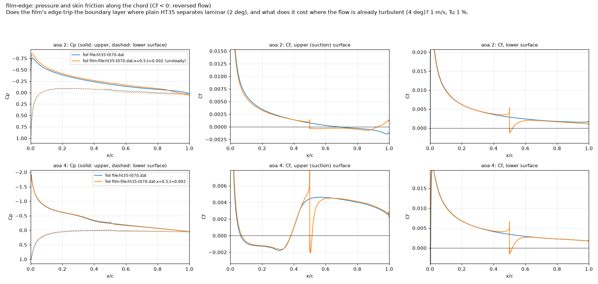

# ht35-film: findings log

Does a self-adhesive film wrapped round the nose of an existing HT35 fin
pay? The film is the buildable version of the step cut into NACA 0007 in
stepped-vs-baseline: 0.2 mm thick, from x/c 0.5 on one surface round the
leading edge to x/c 0.5 on the other, its edge a 0.2 mm step. Unlike the
cut, it adds material ahead of the step. Base: HT35 at 7.0 %, 100 mm chord
(an existing 7 mm fin; user, 2026-10-25), with and without the film, so the
film is the only difference. HT35 at 7.25 % is the recommendation of
[custom-section.md](custom-section.md).

Newest run first. Results live in `runs/ht35-film/<run id>/` (not in git),
so the numbers that support a conclusion are copied here. Symbols follow
[docs/nomenclature.md](../../../docs/nomenclature.md): S_h, D_h = D_v + D_i,
section angle α.

## Run 20261025-145441 (2026-10-25, git a5641dc, GCP, 108 cases)

**Setup.**
* Two sections at 100 mm chord:
  * plain HT35 at 7.0 % (`file:ht35-t070.dat`);
  * the same with the film (`film:file:ht35-t070.dat:x=0.5,t=0.002`). The
    film is an exact 0.2 mm offset of the section ahead of the edge. That
    moves the leading edge 0.2 mm forward, grows the nose radius from 0.69
    to 0.89 mm, and makes the section 7.40 mm thick. The edge is square,
    with a 10 µm fillet at the lip and 50 µm at the foot. Behind it is the
    bare section.
* Swept: Tu 0.1, 1 and 2 %; 0.75, 1.0 and 1.5 m/s; α 0, 2, 3, 4, 5 and 6°.
  These are the custom-section settings.
* Fixed: kOmegaSSTLM, steady (simpleFoam), medium mesh, with the step's mesh
  refined to a fraction of its height (cmesh.py).
* Compute: image `iom-cfd:a5641dc`, c3d-standard-16 Spot VMs, 4 ranks per
  case.
* Previous run: the one-case local check 20261025-143715 (git
  83778d7-dirty, same code). It is the film at Tu 1 %, 1 m/s, 4°, and this
  run repeats it to 2e-5 in Cd (0.014879) and 1e-5 in Cl (0.4323), on arm64
  against amd64.

**Outcome.** 100 ok, 8 not converged, 0 failed.
* All 8 not-converged cases are at Tu 0.1 %: 5 plain, 3 film. They are at
  2° (1), 4° (5) and 5° (2). Plain HT35 at 4° is not converged at all
  three speeds.
* 29 cases are flagged unsteady: 21 of 36 at Tu 0.1 %, 8 of 36 at Tu 1 %
  and none at Tu 2 %.
* Compute: 14.5 case-hours, median 7 min per case.

### Conclusions

1. **The film doesn't pay. It costs 0.16 % of race time at Tu 1 % and
   0.46 % at Tu 2 %, with the resistance slope ×1. With the slope ×2 the
   costs are 0.06 % and 0.23 %.**
   * Most of the cost comes from the light and working loads (α about
     0.5-3.5°) and from downwind.
   * At Tu 1 % the cost is between −0.36 and +0.08 % per point, and the film
     is slower at 7 of 9 load points.
   * At Tu 2 % the cost is between −1.05 and +0.02 % per point, and the film
     is slower at 8 of 9.
   * Confidence: medium.
     * Tu 2 % is steady flow throughout.
     * At Tu 1 %, 8 of 36 cases are unsteady.
     * The size of the cost is uncertain by about as much as the step's
       mesh dependence (see Compromises).
2. **It gives back about half of plain HT35's gain over NACA 0007/100 at
   Tu 1 %, and at Tu 2 % it makes HT35 slower than NACA 0007.**
   * Race-time gain over NACA 0007, slope ×1:
     * Tu 1 %: plain HT35 at 7.0 % gains +0.36 %, filmed +0.20 %.
     * Tu 2 %: plain +0.10 %, filmed −0.37 %.
   * The same method gives +0.34 % and +0.01 % for HT35 at 7.25 %,
     reproducing custom-section.md.
   * Confidence: medium. The NACA 0007 cases are from earlier runs with the
     same settings.
3. **At 0° (downwind) the film adds 1-8 % section drag in all 9
   comparisons.**
   * The amounts by Tu are:
     * Tu 0.1 %: +2.1 to +3.2 %.
     * Tu 1 %: +1.1 to +1.2 %.
     * Tu 2 %: +1.2 to +7.7 %.
   * Where the boundary layer stays laminar (Tu 0.1 and 1 %), the edge does
     not trip it:
     * A bubble behind the edge reattaches 10-21 step heights downstream.
     * After it, the boundary layer stays laminar: aft friction (Cf over x/c
       0.6-0.95 of the upper surface) is the same as on the bare section,
       0.0005-0.0010.
     * The cost is the bubble's pressure drag. For example, at Tu 1 % and
       1 m/s, pressure drag is +0.00042 and friction drag −0.00030.
   * At Tu 2 % the edge brings transition forward:
     * At 1.5 m/s, aft Cf rises from 0.0021 to 0.0031.
     * Friction drag rises by 0.00051, and that point has the largest cost,
       +7.7 %.
   * Confidence: high, as far as the model goes. The model can only see the
     edge through the bubble behind it (Assumptions).
4. **The cut-step result of stepped-vs-baseline does not carry over to the
   film.**
   * In stepped-vs-baseline, the trip cut into NACA 0007 at x/c 0.5 gave 3 %
     less drag at 2° (time-accurate, Tu 1 %, 1 m/s). This study's
     description took that as its motivating evidence.
   * The film at 2° does something similar to the flow:
     * Plain HT35 separates laminar at x/c 0.68 and doesn't reattach.
     * With the film, the flow separates at the edge (x/c 0.50) and
       reattaches turbulent at 0.93.
     * Cl rises from 0.210 to 0.241, and Cd changes by −0.25 %.
   * At equal side force, though, the film costs drag:
     * Tu 1 %: +1.5 to +3.3 % at the force plain HT35 makes at 2°.
     * Tu 2 %: +2.1 to +4.6 % at the same comparison point.
     * So the extra lift isn't free.
   * At 0° the cut trip was 0.9 % better than plain NACA 0007 (steady), and
     the film is 1.1 % worse than plain HT35 (steady, 1 m/s, Tu 1 %).
     * The cut trip is also 6.5 % thinner behind the step. That difference
       is a plausible cause of its 0° gain.
     * This is an **inference**: stepped-vs-baseline isn't written up yet,
       and the bases differ.
   * Confidence: low to medium. The 2° comparisons are steady, at an angle
     where steady answers have been unreliable at Tu 0.1 %.
5. **At high load the film helps. At the side force plain HT35 makes at
   6°, the film needs 1.4-3.8 % less drag at Tu 1-2 % (6 of 6). Those
   forces are above every design load.**
   * The film lowers pressure drag at 5-6° in 16 of 18 cases.
   * At Tu 1-2 %, the suction peak is 0.4-6 % lower in 17 of 18 cases at
     4-6°. This is consistent with the 0.2 mm larger nose radius.
   * At 6° and Tu 0.1-1 %, the film removes plain HT35's leading-edge bubble
     in 4 of 6 cases: all four at 0.75 and 1 m/s. At 1.5 m/s the bubble
     stays.
   * The design "high" load at 1 m/s (8.33 N) needs α 4.4°. The race-time
     metric therefore sees only part of this gain, through the 5° points.
   * It would matter in gusts or out of tacks, but this is **not
     quantified**.
   * Confidence: medium. The flow is steady at Tu 1-2 % at 5-6°.
6. **At Tu 0.1 % the steady answer is inconclusive. The film's race-time
   gain is −0.14 % (slope ×1) or +0.01 % (×2), and the spread over the 9
   points runs from −0.71 to +0.81 %.**
   * The light and working loads favour the plain section: the film is
     slower at 5 of 6 points.
     * At 0.75-1 m/s it is slower at 4 of 4, by 0.32-0.71 % of race time.
     * Those points come from 0-3° cases, 1 of 12 not converged.
   * The high load favours the film at 3 of 3 points. But those comparisons
     rest on plain HT35's not-converged 4° points.
   * Repeat noise:
     * Plain HT35 at Tu 0.1 % repeats custom-section-screen (run
       20261018-043724) to within 0.22 % in Cd at 13 of 18 points.
     * The other five differ by 0.64-1.61 % in Cd and by up to 0.031 in Cl:
       1 m/s 4° and 5°, 1.5 m/s 4° and 5° (not converged in at least one of
       the two runs), and 1.5 m/s 0° (unsteady).
     * That noise is as large as the film's effect at those angles.
   * Confidence: low.

### Evidence

**Race-time gain of the film over plain HT35 at 7.0 %**, % of race time (+ =
the film is faster):
* Mean of the 9 points: 3 speeds × 3 loads of `design/loads.csv`.
* Up and down are each leg's share of the mean, slope ×1.
* Computed with `iomcfd.racetime` from report/selection.csv.

| Tu | slope ×1 | slope ×2 | up | down | worst / best point | light / working / high (×1) |
|---|---|---|---|---|---|---|
| 0.1 % | −0.14 | +0.01 | +0.06 | −0.20 | −0.71 / +0.81 | −0.31 / −0.43 / +0.33* |
| 1 % | −0.16 | −0.06 | −0.07 | −0.08 | −0.36 / +0.08 | −0.18 / −0.26 / −0.03 |
| 2 % | −0.46 | −0.23 | −0.16 | −0.30 | −1.05 / +0.02 | −0.58 / −0.51 / −0.30 |

\* rests on plain HT35's not-converged 4° points.

**Race-time gain over NACA 0007/100**, % (slope ×1 / ×2):
* NACA 0007: custom-section-screen (Tu 0.1 %, run 20261018-043724) and
  custom-section-tu (Tu 1 and 2 %, run 20261018-104350).
* Plain HT35 at 7.0 % and the film: this run.
* Same loads and method as above.

| Tu | HT35 7.0 % | HT35 7.0 % + film | HT35 7.25 % (custom-section) |
|---|---|---|---|
| 0.1 % (steady) | +0.79 / +0.47 | +0.65 / +0.48 | (time-accurate: +0.66 / +0.38) |
| 1 % | +0.36 / +0.20 | +0.20 / +0.14 | +0.34 / +0.20 |
| 2 % | +0.10 / +0.04 | −0.37 / −0.18 | +0.01 / +0.00 |

**Fin drag D_h of the film relative to plain HT35 at equal side force S_h**:
* The forces are what plain HT35 makes at the reference α.
* Whole fin, 360 mm span, section + induced drag.
* From report/selection_compare.csv. '*' = an unsteady or not-converged
  point; '-' = above the film's pre-stall range.

| speed [m/s] | ref α | Tu 0.1 % | Tu 1 % | Tu 2 % |
|---|---|---|---|---|
| 0.75 | 2° | +8.9 %* | +2.3 %* | +2.1 % |
| 0.75 | 4° | −3.2 %* | +0.3 % | +0.9 % |
| 0.75 | 6° | −5.7 %* | −3.8 % | −2.4 % |
| 1.0 | 2° | +6.6 %* | +1.5 %* | +3.3 % |
| 1.0 | 4° | −1.4 %* | +0.4 % | +1.0 % |
| 1.0 | 6° | −7.4 %* | −3.8 % | −2.0 % |
| 1.5 | 2° | +1.8 %* | +3.3 %* | +4.6 % |
| 1.5 | 4° | +1.0 %* | +0.8 % | +1.2 % |
| 1.5 | 6° | - | −2.3 % | −1.4 % |

**Section drag at 0°**, Cd plain → film (change), results.csv:

| speed [m/s] | Tu 0.1 % | Tu 1 % | Tu 2 % |
|---|---|---|---|
| 0.75 | 0.01222 → 0.01259 (+3.0 %) | 0.01249 → 0.01263 (+1.2 %) | 0.01308 → 0.01324 (+1.2 %) |
| 1.0 | 0.01059 → 0.01093 (+3.2 %) | 0.01089 → 0.01100 (+1.1 %) | 0.01149 → 0.01183 (+2.9 %) |
| 1.5 | 0.00878 → 0.00896 (+2.1 %) | 0.00900 → 0.00911 (+1.2 %) | 0.01006 → 0.01084 (+7.7 %) |

**The film-edge highlight** (1 m/s, Tu 1 %; report/highlights.md):

| α | section | Cl | Cd | Cd friction | upper separation → reattachment (x/c) |
|---|---|---|---|---|---|
| 2° | plain | 0.2099 | 0.01171 | 0.00723 | 0.676 → none (to the trailing edge) |
| 2° | film | 0.2410 | 0.01168 | 0.00699 | 0.500 → 0.928 (unsteady) |
| 4° | plain | 0.4303 | 0.01474 | 0.00756 | 0.065 → 0.381 |
| 4° | film | 0.4323 | 0.01488 | 0.00757 | 0.072 → 0.381, then 0.500 → 7.2 step heights |

Drawn by `uv run iomcfd report foil2d/ht35-film --run-id 20261025-145441`
(report/highlight_film-edge.png). At 2°:
* The film's edge moves the upper surface's separation forward from 0.68 to
  0.50, and the flow reattaches near the trailing edge.
* On the lower surface, a short bubble sits behind the edge.

At 4° the boundary layer is already turbulent at the edge (after the
leading-edge bubble), and the edge adds a bubble of 7 step heights.

**Mechanism at 5-6°** (results.csv, report/surface.csv):
* Pressure drag changes by −0.0002 to −0.0035 in 16 of 18 cases. The
  exceptions are Tu 0.1 % at 1 m/s 5° (−0.00007) and 1.5 m/s 6° (+0.0010).
* Friction drag changes by −0.0001 to +0.0011; it rises in 17 of 18 cases.
* At Tu 1-2 % the suction peak is lower, for example −3.13 → −3.01 at 6°,
  1.5 m/s, Tu 1 %.

### Decisions

* **Don't wrap the existing HT35 fin in a 0.2 mm film.** It is slower
  wherever the steady CFD is reliable (Tu 1-2 %). At Tu 0.1 % it is slower
  downwind and at the light and working loads.
* No time-accurate check for now. Its likely outcome doesn't change the
  decision:
  * Time-accurate runs could change only the Tu 0.1 % points at 2-5°.
  * The downwind cost (9 of 9) and the working-load cost at Tu 0.1 %
    (3 of 3) come from converged points.
  * The cost of checking: a 0.2 mm step needs a time step near 7e-5 s,
    about 48 h per case for 20 flow-throughs at 4° (study description).

### Assumptions

* **The film's shape:**
  * a smooth, exact offset of the section;
  * a square edge at x/c 0.50 on both surfaces, with a 10 µm lip fillet
    and a 50 µm foot fillet;
  * no surface roughness;
  * the edge straight along the span.
  * A real tape's edge can be feathered, lifted or ragged. **Not
    verified**.
* **Transition model (kOmegaSSTLM):**
  * Transition comes from Tu and the pressure gradient through
    correlations.
  * A step acts on it only through the separation it causes. The model has
    no roughness-induced (bypass) transition.
  * By a flat-plate estimate the step is 0.4-0.6 laminar displacement
    thicknesses: δ* = 1.72 x/√Re_x at x = 50 mm is 0.34-0.48 mm at
    1.5-0.75 m/s, with ν = 1.14e-6 m²/s. So a strong trip is not expected
    either way.
  * **Estimate, not verified.**
* **Race-time inputs as custom-section.md:**
  * the loads of `design/loads.csv`;
  * the resistance slope VDRDV of `iomcfd.racetime`, an estimate, run at
    ×1 and ×2 (**not verified**);
  * track 42°, span 360 mm, e = 0.9;
  * equal time upwind and downwind.
* The Tu values stand for calm, moderate and rough water, as in
  fin-profile-selection. The pond's turbulence has not been measured.
* The NACA 0007 numbers come from earlier runs (image 6d541d0) at the same
  settings. They were not rerun.

### Compromises

* **Steady solver.** At Tu 0.1 % that leaves 8 cases not converged and 21
  of 36 unsteady, so conclusion 6 is low confidence. At Tu 1 %, 8 of 36
  cases are unsteady. They are all six 0° cases and two at 2° (the film at
  1 m/s, plain at 0.75 m/s), and they enter the downwind leg and the light
  load.
* **Medium mesh, and the film's edge was not mesh-checked.**
  * In stepped-checks (run 20261013-190301), stair1's 0.95 mm step moved Cd
    by +2.3 % from the medium to the fine mesh.
  * The film's costs at the working load (0.3-1.2 %) are smaller than that,
    so their size is uncertain.
  * Their sign is consistent across speeds and Tu (6 of 6 at Tu 1-2 % at
    4°).
* **Angles 0-6° in 1-2° steps.** The race-time metric interpolates linearly
  between them. The light load (0.5-1.8°) is interpolated between 0 and 2°,
  where the lift is non-linear.
* **One film:** 0.2 mm thick, edge at x/c 0.5. Thinner films or other edge
  positions were not run.

### Learnings

* **Physics:**
  * Adding material ahead of a step doesn't reproduce the cut trip.
  * At 0°, the 0.2 mm edge doesn't trip a laminar boundary layer in this
    model: it adds a bubble and a little pressure drag.
  * At Tu 2 % it advances transition, which is all cost.
  * The one benefit, at high α, comes from the blunter nose, not from the
    edge.
* **Repeatability:**
  * A steady case repeats to 1e-5 across architectures (local arm64
    against cloud amd64).
  * A converged steady case repeats to within 0.22 % across images (plain
    HT35 against custom-section-screen).
  * Cases that are not converged or unsteady move by up to 1.6 % in Cd and
    0.03 in Cl. That is the noise floor for steady comparisons at Tu 0.1 %
    at 4-5°.
* **Compute:** 108 steady cases took 14.5 case-hours. The run took 59 min
  of wall time on 18 parallel tasks.
* **Report:** sectionplot's sheet title is cut off for long film specs
  (report/section_film_*.png). This is cosmetic.

### Open questions and next steps

* **If calm water matters most:** check Tu 0.1 % with time-accurate runs, at
  1 m/s and 2-5°, for both sections (8 cases), as custom-section-transient
  did. This would settle conclusion 6. Expect about 48 h per film case at
  4° (time step about 7e-5 s).
* **A thinner film:** a 0.1 mm or 0.05 mm film edge, steady, Tu 1-2 %
  (36-72 cases, about 5-10 case-hours).
  * It would shrink the edge's cost. Nothing here suggests it would turn
    the cost into a gain at 0-4°.
  * Worth running only if a film is wanted for another reason, such as
    protecting the leading edge.
* **Write up stepped-vs-baseline**, separating the trip's effect from its
  thinner rear (conclusion 4).
* **Highlights for a time-accurate run:**
  * `film-calm`: 1 m/s, Tu 0.1 %, 2-5°, compare along foil. These are the
    points whose steady answers are not converged or are noise-limited.
  * `film-2deg`: 1 m/s, Tu 1 %, 2°. Is the film's long bubble behind the
    edge (x/c 0.50 → 0.93, unsteady) real, and does it keep the +0.03 in
    Cl?
