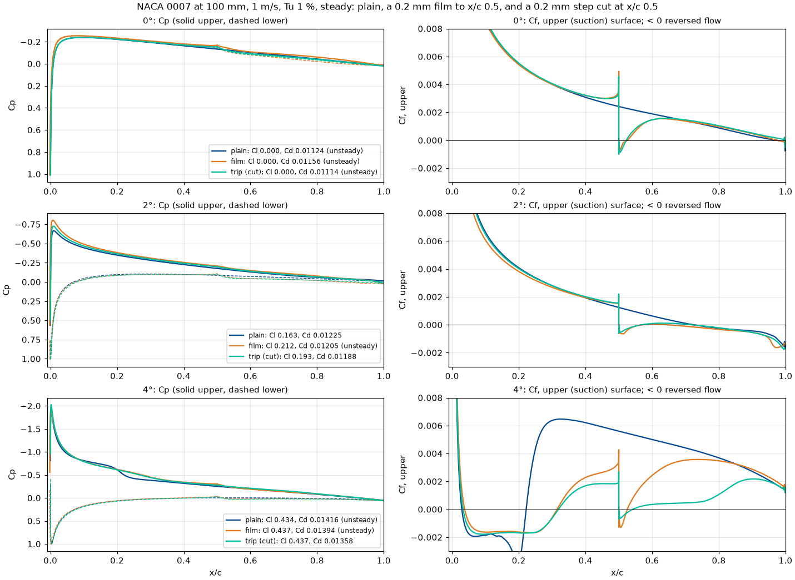

# naca0007-film: findings log

Does a self-adhesive film wrapped round the nose of an existing NACA 0007
fin pay? And how does it compare with the cut trip of stepped-vs-baseline?
Both have the same 0.2 mm edge at x/c 0.5. The film adds material ahead of
the edge; the trip removes it behind the edge. This is the
[ht35-film](ht35-film.md) study on NACA 0007 at 100 mm, the all-round
recommendation of [fin-profile-selection.md](fin-profile-selection.md).
The trip runs in its own study, `naca0007-trip`, and is analysed here; so
is `naca0007-faired`, the trip with its step faired out, which separates the
step's effect from its thinner rear's.

Newest entry first. Results live in `runs/naca0007-film/<run id>/`,
`runs/naca0007-trip/<run id>/` and `runs/naca0007-faired/<run id>/` (not in
git), so the numbers that support a conclusion are copied here. Symbols follow
[docs/nomenclature.md](../../../docs/nomenclature.md): S_h, D_h = D_v + D_i,
section angle α.

## Run 20261025-211238 (faired step) (2026-10-25, git 631baad, GCP, 54 cases)

**Setup.**
* One section, `faired:naca0007:x=0.5,h=0.002,l=0.1` (stepped.py
  `faired`): the cut trip of the entry below with its step filled in and
  sanded smooth.
  * Plain NACA 0007 to x/c 0.5. From there the thickness factor F falls
    from 1 to the trip's 0.935 over x/c 0.5-0.6 by a quintic smoothstep
    (continuous curvature). Behind x/c 0.6 it is the trip's section.
  * No step, so it is a smooth section: meshed like plain NACA 0007 (90,112
    cells, max non-orthogonality 23.6°, the same as plain).
  * Against plain it isolates the thinner rear (plus the ramp); against the
    trip, the step.
  * The 10 mm fairing length is a choice: shorter is closer to the trip,
    longer is a milder pressure gradient.
* Swept as the entry below: Tu 0.1, 1 and 2 %; 0.75, 1.0 and 1.5 m/s; α 0,
  2, 3, 4, 5 and 6°. kOmegaSSTLM, steady, medium mesh, 100 mm chord.
* Image `iom-cfd:631baad`. Plain and trip ran on a5641dc; between the two
  `git diff` shows only the new `faired` option in `geometry/stepped.py`
  and `foils.py` (no change to src/ otherwise, the foil2d template,
  project.py, defaults.yaml, docker/ or geometry/). Plain was not rerun in
  this job.

**Outcome.** 48 ok, 6 not converged, 0 failed.
* Not converged: 5 at Tu 0.1 %, 1 at Tu 1 % (1 m/s, 4°; plain's twin in
  the entry below is not converged either).
* Unsteady: 14 of 18 at Tu 0.1 %, 6 of 18 at Tu 1 % (all three 0° cases,
  0.75 m/s 2°, 1 and 1.5 m/s 4°), none at Tu 2 %.
* 4.6 case-hours (median 3.7 min, max 14.9). The job took 22 min of wall
  time at 18 tasks at once.

### Conclusions

1. **The thinner rear alone is worth +0.17 % of race time at Tu 1 % (slope
   ×1; +0.09 % with ×2), about 40 % of the trip's +0.40 %.**
   * Faster than plain at 7 of 9 load points (−0.27 to +0.42 %).
   * Per load, faired against trip: light +0.26 / +0.23, working +0.18 /
     +0.32, high +0.06 / +0.64. So the rear accounts for all of the trip's
     light-load gain and none of its high-load gain.
   * Upwind +0.06 % (trip +0.31 %); downwind +0.11 % (trip +0.09 %).
   * Confidence: medium. All 0° cases at Tu 1 % are unsteady, in all three
     sections, and the light loads (α 0.7-1.5°) interpolate from 0°. The
     differences at 0° are about 1 %, above plain's repeat noise at most
     Tu 1 % points (14 of 18 within 0.25 %, entry below).
2. **The trip's 0° gain is its thinner rear, not its step. This confirms
   conclusion 4 of the entry below, which was an estimate.**
   * 0° Cd at Tu 1 %, against plain: faired −1.2 / −1.3 / −1.9 %, trip
     −0.7 / −0.8 / −2.0 % (0.75 / 1 / 1.5 m/s).
   * Friction is 1.0-1.2 % lower than plain's (the trip's 1.4-2.4 %), from
     results.csv Cd_friction.
   * At Tu 0.1 % and 2 % (0.75 and 1 m/s) the faired section is as good as
     the trip or better at 0°.
   * Confidence: medium (0° flow unsteady at Tu 0.1 and 1 %; steady at
     Tu 2 %).
3. **At 2° the fairing does what the step does: a 0.2 mm ramp over 10 mm
   sets off a laminar bubble on the ramp, and Cl and Cd come out the same as
   the trip's.**
   * 1 m/s, Tu 1 % (report/highlights.md of each run):

     | section | Cl | Cd | upper surface |
     |---|---|---|---|
     | plain | 0.1633 | 0.01225 | laminar separation at x/c 0.72, no reattachment |
     | trip | 0.1930 | 0.01188 | step bubble 0.50-0.57; separates again at 0.72 |
     | faired | 0.1945 | 0.01193 | bubble 0.57-0.63 on the ramp; separates again at 0.66 |

   * At equal side force S_h the trip's fin drag is within 0.3 % of the
     faired section's at 2°, Tu 1 %, at all three speeds.
   * **Correction:** the naca0007-trip and naca0007-faired study
     descriptions say the trip "closed" plain's separation at x/c 0.72. In
     these steady runs neither the trip nor the faired section reattaches
     before the TE: Cf is negative from x/c 0.72 (trip) or 0.66 (faired) to
     the TE (figure). What both do is lift Cl by 0.03 and cut Cd by 2.6-3.0 %.
   * Confidence: medium. One speed, steady. The trip's 2° case repeats
     time-accurate (entry below); the faired 2° case at 1 m/s is steady
     flow, not checked time-accurate.
4. **What the step adds over the faired section, +0.23 % at Tu 1 % (×1),
   comes from the working and high loads and rests on unsteady 4° cases.
   Low confidence.**
   * Trip minus faired per load: light −0.03, working +0.14, high +0.58 %.
   * At equal S_h, trip against faired at 4°, Tu 1 %: +0.7 % at 0.75 m/s
     (no unsteady case involved), −6.5 %* at 1 m/s, −4.0 %* at 1.5 m/s.
   * At 4° all three sections have a long leading-edge bubble on the upper
     surface: separation at x/c 0.027-0.033, reattachment at 0.22 (plain),
     0.32 (trip) and 0.38 (faired), in the last steady iterate. Only the
     trip's is steady flow. The trip's lower drag there is mostly friction
     (0.00574 against plain's 0.00624).
   * The steady solver overstates plain's drag there:
     * stepped-vs-baseline (run 20261023-201101, image 094ffb4) ran plain
       at 4°, 1 m/s, Tu 1 % both ways: steady Cd 0.01418, unsteady;
       time-accurate 0.01382 (20 flow-throughs, Cd std 0.00033), 2.5 %
       lower.
     * With the time-accurate value in place of plain's steady one, the
       trip's Tu 1 % gain becomes +0.37 % and the faired +0.14 %.
     * If the faired section's unsteady 4° case is 2.5 % high too (an
       assumption, **not verified**), faired is back to +0.17 % and the
       step's share is +0.21 %.
   * The high loads (α 3.8-4.4°) interpolate across a steep drag rise:
     plain's Cd goes from 0.01416 at 4° to 0.02139 at 5° (1 m/s, +51 %), so
     they are sensitive to the 4° case's Cl.
   * The trip's time-accurate 4° case (stepped-vs-baseline task 11) is
     still running. There is no time-accurate faired case.
5. **At Tu 2 % the faired section breaks even (−0.02 %, faster at 6 of 9);
   the trip loses 0.15 %.**
   * Both lose at 1.5 m/s. Per load (light / working / high): faired −0.37
     / −0.20 / −0.19 %, trip −0.75 / −0.49 / −0.43 %.
   * At 0.75 and 1 m/s the faired section gains up to 0.18 %.
   * 0° friction at 1.5 m/s: plain 0.00772, faired 0.00816 (+5.7 %), trip
     0.00836 (+8.3 %). Plausibly both move transition forward on a boundary
     layer that plain keeps laminar further; inferred from friction, the
     transition positions at 1.5 m/s were not extracted.
   * Confidence: medium-high. Tu 2 % is steady flow throughout, and plain
     repeats to 0.01 % there.
6. **At Tu 0.1 % the faired section gains +0.06 % (faster at 6 of 9, −1.25
   to +0.73 %). This is noise-limited:** 14 of 18 cases are unsteady, 5 not
   converged, and plain's repeat noise reaches 11 % (entry below).
7. **The ranking doesn't change: plain HT35 at 7 % is still the best section
   at every Tu.** Among NACA 0007 variants:
   * the trip has the most upside, at Tu 1 %;
   * the faired section has the least downside: it never averages below
     −0.02 %.

### Evidence

**Race-time gain over plain NACA 0007**, % of race time (+ = faster):
* Mean of 9 points: 3 speeds × 3 loads of `design/loads.csv`; up and down
  are each leg's share, slope ×1.
* `iomcfd.racetime` (`fin_forces`, `race_time`) on the three runs'
  results.csv: plain from naca0007-film 20261025-161234, trip from
  naca0007-trip 20261025-173646, faired from this run.
* The trip rows repeat the entry below.

| Tu | section | slope ×1 | slope ×2 | up | down | faster at | range | light / working / high |
|---|---|---|---|---|---|---|---|---|
| 0.1 % | faired | +0.06 | +0.04 | −0.11 | +0.17 | 6/9 | −1.25..+0.73 | +0.37 / +0.24 / −0.43 |
| 0.1 % | trip | +0.24 | +0.17 | +0.21 | +0.03 | 5/9 | −0.86..+2.34 | +0.30 / −0.13 / +0.54 |
| 1 % | faired | +0.17 | +0.09 | +0.06 | +0.11 | 7/9 | −0.27..+0.42 | +0.26 / +0.18 / +0.06 |
| 1 % | trip | +0.40 | +0.22 | +0.31 | +0.09 | 9/9 | +0.12..+0.73 | +0.23 / +0.32 / +0.64 |
| 2 % | faired | −0.02 | −0.01 | +0.02 | −0.04 | 6/9 | −0.37..+0.18 | −0.04 / −0.05 / +0.04 |
| 2 % | trip | −0.15 | −0.07 | −0.04 | −0.11 | 4/9 | −0.75..+0.21 | −0.19 / −0.21 / −0.04 |

**All six sections, race-time gain over plain NACA 0007**, % (slope ×1 /
×2). The others from the entry below (image a5641dc); faired on 631baad.

| section | Tu 0.1 % | Tu 1 % | Tu 2 % |
|---|---|---|---|
| HT35 7.0 % | +0.59 / +0.36 | +0.45 / +0.25 | +0.10 / +0.04 |
| NACA 0007 trip | +0.24 / +0.17 | +0.40 / +0.22 | −0.15 / −0.07 |
| HT35 7.0 % + film | +0.46 / +0.37 | +0.30 / +0.19 | −0.37 / −0.18 |
| NACA 0007 faired | +0.06 / +0.04 | +0.17 / +0.09 | −0.02 / −0.01 |
| NACA 0007 + film | −0.29 / −0.09 | +0.05 / +0.06 | −0.37 / −0.18 |

**Fin drag D_h at equal side force S_h** (whole fin, 360 mm span, section
+ induced drag; `iomcfd.racetime.at_force` at the force plain makes at the
reference α; '*' = an unsteady or not-converged case among the bracketing
points):

| speed [m/s] | ref α | faired/plain, Tu 0.1 % | Tu 1 % | Tu 2 % | trip/faired, Tu 0.1 % | Tu 1 % | Tu 2 % |
|---|---|---|---|---|---|---|---|
| 0.75 | 2° | +0.6 %* | −0.5 %* | −0.3 % | −1.0 %* | −0.2 %* | +0.0 % |
| 0.75 | 4° | +4.4 %* | −0.8 % | −0.1 % | +2.4 %* | +0.7 % | +0.5 % |
| 0.75 | 6° | −0.4 %* | −0.5 % | −0.4 % | −3.8 %* | −2.3 % | −1.1 % |
| 1.0 | 2° | +1.4 %* | −1.5 %* | +0.6 % | −0.2 %* | −0.3 %* | +0.6 % |
| 1.0 | 4° | +2.0 %* | +4.2 %* | −0.4 % | +10.0 %* | −6.5 %* | +0.6 % |
| 1.0 | 6° | −0.3 %* | −0.4 % | −0.3 % | −5.0 %* | −1.1 % | −0.7 % |
| 1.5 | 2° | +0.7 %* | −1.0 %* | +1.0 % | −1.5 %* | −0.3 %* | +1.8 % |
| 1.5 | 4° | −0.1 %* | −0.8 %* | −0.3 % | +1.3 %* | −4.0 %* | +0.2 % |
| 1.5 | 6° | +0.3 %* | −0.2 % | −0.2 % | +0.8 %* | −0.1 % | +0.2 % |

**Section drag Cd at 0°** (results.csv; plain and trip as in the entry
below):

| Tu | speed [m/s] | plain | trip | faired |
|---|---|---|---|---|
| 0.1 % | 0.75 | 0.01258 | 0.01281 (+1.8 %) | 0.01239 (−1.5 %) |
| 0.1 % | 1.0 | 0.01115 | 0.01101 (−1.3 %) | 0.01083 (−2.9 %) |
| 0.1 % | 1.5 | 0.00932 | 0.00913 (−2.1 %) | 0.00910 (−2.4 %) |
| 1 % | 0.75 | 0.01288 | 0.01279 (−0.7 %) | 0.01273 (−1.2 %) |
| 1 % | 1.0 | 0.01124 | 0.01114 (−0.8 %) | 0.01109 (−1.3 %) |
| 1 % | 1.5 | 0.00937 | 0.00918 (−2.0 %) | 0.00919 (−1.9 %) |
| 2 % | 0.75 | 0.01340 | 0.01327 (−1.0 %) | 0.01326 (−1.0 %) |
| 2 % | 1.0 | 0.01173 | 0.01169 (−0.4 %) | 0.01165 (−0.6 %) |
| 2 % | 1.5 | 0.00988 | 0.01047 (+6.0 %) | 0.01021 (+3.3 %) |

Figure: [figures/naca0007-faired.png](figures/naca0007-faired.png), Cp and
upper-surface Cf of plain, trip and faired at 1 m/s, Tu 1 %, 0, 2 and 4°
(from each case's surface.csv).

### Decisions

* No change to the fin recommendation: plain HT35 at 7 % stays first.
* On an existing NACA 0007 fin, thinning the rear (the faired section) is
  the change with no measurable downside at Tu 2 %. Cutting the step adds
  about 0.2 % at Tu 1 % on low-confidence evidence (conclusion 4), and
  costs 0.13 % more than the faired section at Tu 2 %.
* `faired:` stays as a section option (stepped.py, test_geometry.py).

### Assumptions

* Loads, course and fin: as the entry below (`design/loads.csv`, VDRDV
  estimate **not verified**; 360 mm span, e = 0.9).
* Plain and trip from earlier runs on image a5641dc stand in for a rerun
  on 631baad: the solver path is unchanged (git diff above), **not
  verified** by a repeat case.
* The faired section's 4° bias (conclusion 4) is assumed equal to plain's:
  **not verified**.
* Transition moving forward at Tu 2 %, 1.5 m/s is inferred from friction
  only.

### Compromises

* Steady solver on unsteady flow: every 0° case at Tu 0.1 and 1 %, and 4°
  at 1 and 1.5 m/s, Tu 1 %. These carry the light and high loads.
* One fairing length (10 mm). The ramp itself trips the boundary layer at
  2° (conclusion 3), so a different length may change the 2° result.
* Cross-run comparison: plain not rerun next to the faired section.
* Highlight figures and separation tables at 1 m/s only.

### Learnings

* On NACA 0007 at Re 1e5 and Tu 1 %, the laminar boundary layer at 2° is
  sensitive enough that a 0.2 mm ramp over 10 mm (at most about 2° of extra
  slope) trips it as a square step does. In kOmegaSSTLM; not checked against
  experiment.
* Steady simpleFoam overstates plain NACA 0007's drag by 2.5 % at 4°, 1 m/s,
  Tu 1 %, where the leading-edge bubble is unsteady. Where one section's
  4° case is steady and another's isn't, steady comparisons favour the
  steady one.
* Compute:
  * 4.6 case-hours, close to plain's 4.9 for the same 54 cases, as
    estimated.
  * Wall time was 22 min against my 30-35 min estimate. This job's own case
    times replayed through 18 slots give 20.1 min, so start-up cost about
    2 min. I had added the trip job's 10 min gap (59 min against a 48 min
    replay), which wasn't start-up; its cause wasn't checked.

### Open questions and next steps

* **Time-accurate 4°, 1 m/s, Tu 1 % for the faired section**:
  * one case, about 9 h of wall time (plain's took 31,194 s);
  * set it against plain's (done) and the trip's (running) to settle
    whether the step gains anything above the light loads.
* **Fairing length**:
  * the same sweep with `l=0.2`: 54 cases, about 5 case-hours, 20-25 min;
  * it tests whether a gentler ramp still trips at 2° and keeps the 0° gain.
  * Highlights for that run:

    ```yaml
    highlights:
      - name: fairing-length
        why: >
          The 10 mm fairing set off a bubble on the ramp at 2 deg (x/c 0.57-0.63) and matched the
          trip; does a 20 mm one still trip, and keep the 0 deg gain? 1 m/s, Tu 1 %.
        where: {speed: 1.0, aoa: [0, 2], Tu: 1.0}
        compare: foil
        views: [boundary_layer, transition]
      - name: faired-tu2-fast
        why: >
          Both the faired section and the trip lose at Tu 2 %, 1.5 m/s, with more friction at 0 deg
          than plain: where does transition move?
        where: {speed: 1.5, aoa: [0, 2], Tu: 2.0}
        compare: foil
        views: [transition]
    ```
* The stepped-vs-baseline findings, still to be written, should use
  conclusion 2 here (the trip's 0° gain is its rear) and conclusion 4's 4°
  numbers.

## Runs 20261025-161234 (film) and 20261025-173646 (trip) (2026-10-25, git a5641dc, GCP, 108 + 54 cases)

**Setup.**
* Three sections at 100 mm chord:
  * plain NACA 0007 (`naca0007`);
  * the film (`film:naca0007:x=0.5,t=0.002`):
    * 0.2 mm, an exact offset of the section from x/c 0.5 on one surface
      round the nose to x/c 0.5 on the other;
    * nose radius 0.54 → 0.74 mm, 7.40 mm thick;
  * the cut trip (`stair1:naca0007:x=0.5,h=0.002`):
    * one 0.2 mm backward-facing step per side at x/c 0.5;
    * plain ahead of the step, scaled to 93.5 % thickness behind it.
  * Both edges are square, with a 10 µm lip fillet and a 50 µm foot
    fillet.
* Swept as ht35-film: Tu 0.1, 1 and 2 %; 0.75, 1.0 and 1.5 m/s; α 0, 2, 3, 4,
  5 and 6°.
* Fixed: kOmegaSSTLM, steady (simpleFoam), medium mesh, with the step's mesh
  refined to a fraction of its height (cmesh.py).
* Compute: image `iom-cfd:a5641dc`, c3d-standard-16 Spot VMs, 4 ranks per
  case.
* Plain and film ran in naca0007-film. The trip ran in naca0007-trip
  straight after, on the same image and settings.

**Outcome.**
* **naca0007-film:** 96 ok, 12 not converged, 0 failed (after one rerun).
  * The 12 not converged: 10 at Tu 0.1 %, 2 at Tu 1 %; 8 of them at 4°.
  * 36 unsteady: 23 of 36 at Tu 0.1 %, 13 of 36 at Tu 1 %, none at Tu 2 %.
  * Plain NACA 0007 at Tu 0.1 %, 1 m/s, 5° failed on GCP:
    * a floating-point exception in the turbulence model at iteration 141;
    * the same case converged in custom-section-screen.
  * It was rerun locally into the same run (`iomcfd run --run-id
    20261025-161234 --only ... --force`):
    * image `iom-cfd:latest`, git 799ac33, with the same `src/`, foil2d
      project and geometry as a5641dc;
    * it reached the iteration limit unconverged at Cl 0.4985, Cd 0.02304;
    * custom-section-screen had Cl 0.4994, Cd 0.02289.
  * 17.8 case-hours.
* **naca0007-trip:** 49 ok, 5 not converged (4 at Tu 0.1 %, 1 at Tu 1 %; 4 of
  the 5 at 4°).
  * 17 unsteady: 11 of 18 at Tu 0.1 %, 6 of 18 at Tu 1 %, none at Tu 2 %.
  * 12.1 case-hours, median 10.6 min per case. The job took 59 min of wall
    time, against an estimate of 30-40 min (Learnings).

### Conclusions

1. **Wrapping NACA 0007 in the film doesn't pay. At Tu 1 % it breaks even
   (+0.05 % of race time, slope ×1; +0.06 % with ×2), and at Tu 2 % it
   costs 0.37 % (0.18 %).**
   * At Tu 1 % the film is faster at 5 of 9 load points (−0.22 to +0.43 %).
   * At Tu 2 % it is faster at 2 of 9 (−1.03 to +0.13 %).
   * At Tu 0.1 % the result is −0.29 % (×1), faster at 4 of 9, and runs from
     −1.55 to +0.89 %. This is noise-limited (conclusion 6).
   * Same verdict as on HT35, where the film cost 0.16 % at Tu 1 % and 0.46 %
     at Tu 2 %.
   * NACA 0007 does a little better at Tu 1 % than HT35 did, because its
     upwind is better with the film (next conclusion).
   * Confidence: medium.
     * Tu 2 % is steady flow throughout.
     * At Tu 1 % the 2° and 4° comparison points rest on unsteady cases
       (13 of 36).
2. **The cut trip is the only variant that pays at Tu 1 %: +0.40 % of race
   time (slope ×1; +0.22 % with ×2), faster at 9 of 9 load points (+0.12 to
   +0.73 %).**
   * Per load: light +0.23, working +0.32, high +0.64 %.
   * At equal side force S_h its fin drag D_h is 0.1-4.7 % lower in 9 of 9
     comparisons.
   * At Tu 2 % it loses 0.15 % (×1), faster at 4 of 9.
   * At Tu 0.1 % it gains +0.24 %, faster at 5 of 9, with a range of −0.86
     to +2.34 %. This is noise-limited.
   * Confidence: medium at Tu 1 %. Steady flow in 12 of 18 trip cases; at 2°
     steady repeats time-accurate (Learnings).
3. **The film and the trip do the same thing to the boundary layer. The
   difference between them is where the material is.**
   * At 1 m/s, Tu 1 %, the upper surface's skin friction behind the edge is
     the same for both at 0° and 2° (figure).
   * Both separate at the edge (x/c 0.50). At 2° plain NACA 0007 separates
     laminar at x/c 0.72 and doesn't reattach.
   * Upwind at Tu 1 % both gain: film +0.19 %, trip +0.31 % of race time.
     The step they share helps NACA 0007 upwind at this Tu. On HT35 the
     film's upwind was −0.07 %.
   * Downwind (0°) they part:
     * The film costs 1.0-2.8 % section drag at Tu 1 %. Its pressure drag is
       +0.00040 to +0.00052, with friction −0.00021 to −0.00028.
     * The trip saves 0.7-2.0 %. Its pressure drag is −0.00006 to
       +0.00003, with friction −0.00012 to −0.00016.
     * The film's thicker front costs pressure drag. The trip's thinner rear
       offsets the bubble behind its step.
   * Confidence: medium. This is inferred from force splits and Cf curves at
     one speed, plus 0° at all speeds.
4. **Most or all of the trip's 0° gain is plausibly its thinner rear, not
   the step.**
   * NACA 0006 against 0007 at 100 mm, 0°, Tu 1 % (fin-profile-selection
     run 20261012-175146): 1 % c less thickness is 3.5-4.2 % less drag at
     0.75-1.5 m/s.
   * The trip's rear is 6.5 % thinner (relative). NACA 0006 is 14 % thinner
     everywhere. That puts the thinner rear at about 0.8-1.6 % less drag:
     half to all of the full-section effect, scaled by 6.5/14.
   * The trip's measured 0° gain is 0.7-2.0 %.
   * This is an **estimate** (linear scaling), **not verified**. A faired
     section with the trip's thickness and no step would settle it.
   * It confirms the doubt raised about stepped-vs-baseline's 0° result in
     ht35-film.md (conclusion 4 there).
   * Confidence: low.
5. **Plain HT35 at 7.0 % is still the best of the five sections. The trip
   brings NACA 0007 close to it at Tu 1 % only.**
   * Race-time gain over plain NACA 0007 (slope ×1), all five on the same
     image:
     * HT35 7.0 %: +0.59 / +0.45 / +0.10 % at Tu 0.1 / 1 / 2 %.
     * NACA 0007 trip: +0.24 / +0.40 / −0.15 %.
     * HT35 7.0 % + film: +0.46 / +0.30 / −0.37 %.
     * NACA 0007 + film: −0.29 / +0.05 / −0.37 %.
   * Against this run's plain NACA 0007, HT35's gain at Tu 1 % is +0.45 %.
     Against custom-section-tu's it is +0.36 % (ht35-film.md). The
     difference is NACA 0007's repeat noise (conclusion 6), about 0.1 % of
     race time.
   * A trip on HT35 is not run.
   * Confidence: medium at Tu 1-2 %; low at Tu 0.1 %.
6. **At Tu 0.1 % no steady answer here is reliable.**
   * Plain NACA 0007 repeats custom-section-screen (run 20261018-043724) to
     within 0.25 % in Cd at only 9 of 17 points.
   * The worst is 11.4 %, at 1 m/s 4°, not converged in both runs.
   * At Tu 1 %, 14 of 18 points repeat custom-section-tu (run
     20261018-104350) to within 0.25 %. The worst is 3.2 % (1 m/s 4°, not
     converged), and 1.5 % at 0.75 m/s 4° with both runs converged and
     steady.
   * At Tu 2 %, 18 of 18 repeat to 0.01 %.
   * Confidence: high (that the noise is this size).

### Evidence

**Race-time gain over plain NACA 0007**, % of race time (+ = faster):
* Mean of 9 points: 3 speeds × 3 loads of `design/loads.csv`.
* Up and down are each leg's share, slope ×1.
* Computed with `iomcfd.racetime` from the runs' results.csv
  (`fin_forces`, `race_time`).

| Tu | section | slope ×1 | slope ×2 | up | down | faster at | range | light / working / high |
|---|---|---|---|---|---|---|---|---|
| 0.1 % | film | −0.29 | −0.09 | −0.13 | −0.16 | 4/9 | −1.55..+0.89 | −0.15 / −0.31 / −0.42 |
| 0.1 % | trip | +0.24 | +0.17 | +0.21 | +0.03 | 5/9 | −0.86..+2.34 | +0.30 / −0.13 / +0.54 |
| 1 % | film | +0.05 | +0.06 | +0.19 | −0.14 | 5/9 | −0.22..+0.43 | −0.20 / −0.01 / +0.36 |
| 1 % | trip | +0.40 | +0.22 | +0.31 | +0.09 | 9/9 | +0.12..+0.73 | +0.23 / +0.32 / +0.64 |
| 2 % | film | −0.37 | −0.18 | −0.12 | −0.25 | 2/9 | −1.03..+0.13 | −0.47 / −0.46 / −0.18 |
| 2 % | trip | −0.15 | −0.07 | −0.04 | −0.11 | 4/9 | −0.75..+0.21 | −0.19 / −0.21 / −0.04 |

**All five sections, race-time gain over plain NACA 0007**, % (slope ×1 /
×2):
* All on image a5641dc: this run, naca0007-trip, and ht35-film run
  20261025-145441.

| section | Tu 0.1 % | Tu 1 % | Tu 2 % |
|---|---|---|---|
| HT35 7.0 % | +0.59 / +0.36 | +0.45 / +0.25 | +0.10 / +0.04 |
| HT35 7.0 % + film | +0.46 / +0.37 | +0.30 / +0.19 | −0.37 / −0.18 |
| NACA 0007 trip | +0.24 / +0.17 | +0.40 / +0.22 | −0.15 / −0.07 |
| NACA 0007 + film | −0.29 / −0.09 | +0.05 / +0.06 | −0.37 / −0.18 |

**Fin drag D_h at equal side force S_h, relative to plain NACA 0007**:
* The forces are what plain NACA 0007 makes at the reference α.
* Whole fin, 360 mm span, section + induced drag.
* Film: report/selection_compare.csv of naca0007-film; '*' = an unsteady or
  not-converged point.
* Trip: the same interpolation (`iomcfd.racetime.at_force`) across the two
  runs; no flags computed.

| speed [m/s] | ref α | film, Tu 0.1 % | film, Tu 1 % | film, Tu 2 % | trip, Tu 0.1 % | trip, Tu 1 % | trip, Tu 2 % |
|---|---|---|---|---|---|---|---|
| 0.75 | 2° | +6.3 %* | +2.5 %* | +1.6 % | −0.5 % | −0.7 % | −0.3 % |
| 0.75 | 4° | +7.4 %* | +0.4 % | +1.1 % | +6.9 % | −0.1 % | +0.3 % |
| 0.75 | 6° | −5.7 % | −4.7 % | −3.3 % | −4.2 % | −2.8 % | −1.5 % |
| 1.0 | 2° | +7.6 %* | +0.6 %* | +2.5 % | +1.2 % | −1.8 % | +1.2 % |
| 1.0 | 4° | +7.5 %* | −1.1 %* | +1.1 % | +12.2 % | −2.6 % | +0.2 % |
| 1.0 | 6° | −7.2 %* | −5.0 % | −3.0 % | −5.2 % | −1.5 % | −1.0 % |
| 1.5 | 2° | −0.0 %* | +0.8 %* | +4.6 % | −0.8 % | −1.3 % | +2.9 % |
| 1.5 | 4° | +8.3 %* | −3.5 %* | +0.7 % | +1.2 % | −4.7 % | −0.1 % |
| 1.5 | 6° | −0.7 %* | −3.5 % | −2.4 % | +1.1 % | −0.3 % | −0.0 % |

**Section drag at 0°**, Cd (change against plain), results.csv:

| Tu | speed [m/s] | plain | film | trip |
|---|---|---|---|---|
| 0.1 % | 0.75 | 0.01258 | 0.01309 (+4.0 %) | 0.01281 (+1.8 %) |
| 0.1 % | 1.0 | 0.01115 | 0.01143 (+2.5 %) | 0.01101 (−1.3 %) |
| 0.1 % | 1.5 | 0.00932 | 0.00931 (−0.1 %) | 0.00913 (−2.1 %) |
| 1 % | 0.75 | 0.01288 | 0.01301 (+1.0 %) | 0.01279 (−0.7 %) |
| 1 % | 1.0 | 0.01124 | 0.01156 (+2.8 %) | 0.01114 (−0.8 %) |
| 1 % | 1.5 | 0.00937 | 0.00955 (+1.9 %) | 0.00918 (−2.0 %) |
| 2 % | 0.75 | 0.01340 | 0.01351 (+0.8 %) | 0.01327 (−1.0 %) |
| 2 % | 1.0 | 0.01173 | 0.01188 (+1.3 %) | 0.01169 (−0.4 %) |
| 2 % | 1.5 | 0.00988 | 0.01067 (+8.0 %) | 0.01047 (+6.0 %) |

At Tu 2 % and 1.5 m/s both edges bring transition forward. Friction drag is
+0.00064 for both, the largest cost in the table, as on HT35 (+7.7 %).



Drawn from the three runs' `surface.csv` by a one-off matplotlib script
(not in the repository). The report can't overlay cases from two runs.
* **0° and 2°:** the film's and the trip's Cf curves behind the edge lie on
  top of each other.
* **4°:**
  * Both edges lengthen the leading-edge bubble, from x/c 0.22 to about
    0.31.
  * Both lower the turbulent friction behind it, the trip's most.
  * Plain NACA 0007 at 4° is not converged and is unsteady.

### Decisions

* **Don't wrap the fin, on NACA 0007 or on HT35.** The film is break-even at
  best (Tu 1 %) and costs 0.37 % of race time at Tu 2 %.
* The cut trip is not recommended yet:
  * Its gain is at Tu 1 % only (+0.40 %), and it loses at Tu 2 % (−0.15 %).
  * Part of that gain may be its thinner rear (conclusion 4).
  * Plain HT35 at 7 % is as good or better at every Tu.
* No time-accurate runs. At Tu 1 % and 2° steady already repeats
  time-accurate (Learnings). At Tu 0.1 % time-accurate runs would cost
  about 48 h per stepped case.

### Assumptions

* **Film and trip shape:**
  * a square edge with fillets;
  * smooth surfaces, no roughness;
  * the edge straight along the span.
  * A real tape edge, or a sanded step, is not that clean. **Not verified**.
* **kOmegaSSTLM:** a step acts on transition only through the separation it
  causes; there is no roughness-induced transition. **Not verified** for a
  0.2 mm step (ht35-film.md, Assumptions).
* **Race-time inputs as custom-section.md:**
  * the loads of `design/loads.csv`;
  * the resistance slope VDRDV, an estimate run at ×1 and ×2 (**not
    verified**);
  * track 42°, span 360 mm, e = 0.9;
  * equal time upwind and downwind.
* The Tu values stand for calm, moderate and rough water. The pond's
  turbulence has not been measured.
* **The thickness sensitivity in conclusion 4:**
  * from NACA 0006 against 0007 (fin-profile-selection run 20261012-175146,
    medium mesh, an older image);
  * scaled linearly to a rear-only thinning. **Estimate**.

### Compromises

* **Steady solver.** At Tu 0.1 % the steady answers are noise-limited, so
  conclusions there are low confidence. At Tu 1 % the film's comparison
  points rest on unsteady cases.
* **Medium mesh, and the edge not mesh-checked.** For a much larger step
  (0.95 mm, stepped-checks), the medium-to-fine change was +2.3 % in Cd.
  That is as large as most differences here.
* **One failed case rerun locally** (same code, different image build and
  hardware). Its value enters the Tu 0.1 % high load at 1 m/s.
* **The trip's flags are not in the equal-force table.** The report can't
  compare across runs.
* **One film and one trip:** 0.2 mm at x/c 0.5. No other heights or
  positions were run.

### Learnings

* **Steady at 2°, Tu 1 %, 1 m/s repeats the time-accurate results of
  stepped-vs-baseline (run 20261023-201101, read from the bucket):**

  | case | steady here | time-accurate (stepped-vs-baseline) |
  |---|---|---|
  | plain | Cl 0.163, Cd 0.01225 | Cl 0.1629, Cd 0.01224 |
  | trip | Cl 0.193, Cd 0.01188 | Cl 0.1932, Cd 0.01188 |

  So at Tu 1 % and this angle the steady solver is enough.
* **The same step behaves the same whether material is added ahead of it or
  removed behind it.** What decides the result is the thickness
  distribution it comes with.
* **Batch marks a whole job FAILED if one task fails.**
  * The chained submit script waited for SUCCEEDED, so it didn't submit the
    trip, and the trip was submitted by hand about 1 min later.
  * A future chain should look at task counts, not the job state.
* **Compute:**
  * Stepped cases (film or trip, 129,536 cells) take a median of about
    11 min: film 10.9, trip 10.6.
  * Plain cases (90,112 cells) take 3.8 min.
  * The trip job's estimate used the median of a mixed run (7-8 min), which
    is why 30-40 min became 59.
  * Estimate stepped-only jobs at about 11 min a case.

### Open questions and next steps

* **Separate the trip's step from its thinner rear:** a faired section with
  the trip's thickness distribution and no step.
  * It needs a new geometry option (stepped.py), e.g. `stair1:...:faired`.
  * Steady over this sweep: 54 cases, about 10 case-hours.
* **A trip cut into HT35** (`stair1:file:ht35-t070.dat:x=0.5,h=0.002`), if a
  trip is still of interest. HT35 separates laminar at 2° too (x/c 0.68,
  ht35-film.md).
* **Highlights for a next run:**
  * `faired-vs-trip`: 1 m/s, Tu 1 %, 0° and 2°, compare along foil. Is the
    0° gain the step or the rear?
  * `trip-tu2`: 1.5 m/s, Tu 2 %, 0°. Both edges move transition forward
    there, and that is the largest cost.
