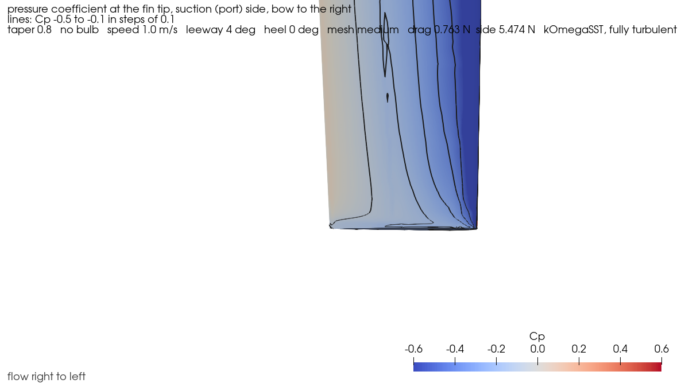
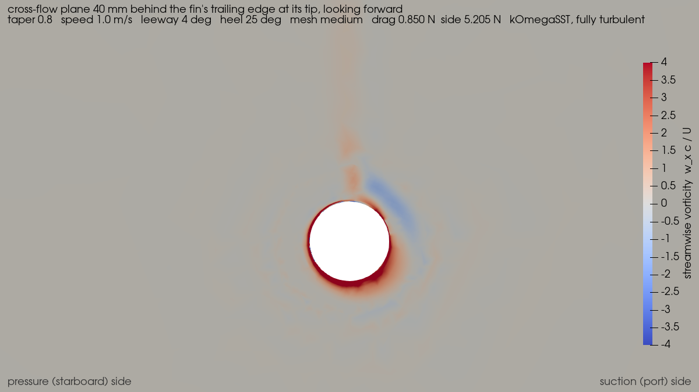
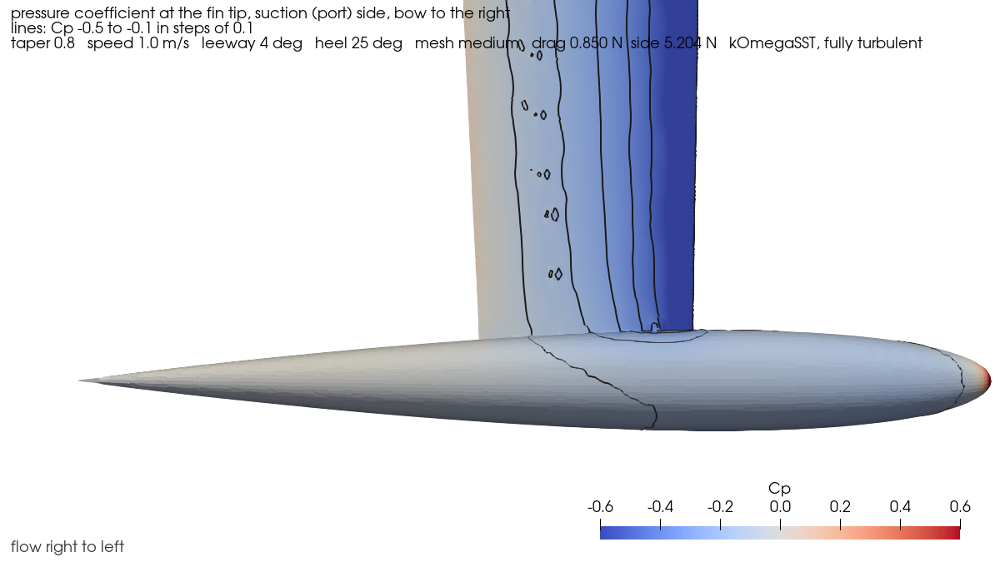
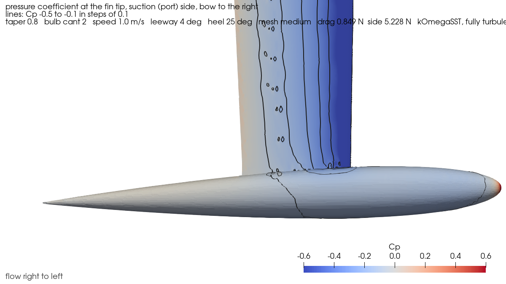

::: {.callout-warning appearance="simple" icon=false}
[**First version.** Every result here comes from simulations, none from tests of real bulbs. The next
step is a custom-designed bulb, compared with the round one below.]{.status}
:::

::: {.key-results}
::: {}
[Round]{.big-number} 
the least race-time loss of the six cross-sections simulated, as computed and with the friction
correction (@sec-section)
:::
::: {}
[343 mm]{.big-number} 
a practical reference, not an optimum: longer bulbs have a little less drag; 251 mm and shorter
separate on the tail (@sec-length)
:::
::: {}
[0–2°]{.big-number} 
nose-up cant: within 0.1\ % of race time of each other; 4° no better and worse in light conditions
(@sec-cant)
:::
::: {}
[+13\ %]{.big-number} 
side force of fin and bulb against the fin alone, at the same 4° leeway: the bulb as an end plate.
Not a speed gain (@sec-endplate)
:::
:::

[**Jump to:** [the answer](#sec-conclusion) · [the bulb and its job](#sec-basics) ·
[method](#sec-method) · results: [how long](#sec-length) · [end plate](#sec-endplate) ·
[how flat](#sec-section) · [how much cant](#sec-cant) · [in 3D](#sec-flow3d)]{.jump-links}

## The bulb and its job {#sec-basics}

### What the bulb does

On an IOM the lead bulb is 60\ % of the boat's mass: 2380 g in a 4 kg boat, here. It does three
things.

**It makes righting moment.** The bulb's lowest point is at the draft limit, 420 mm below the
waterline; its centre of mass is about 19 mm higher, some 401 mm down. Upright, its weight and the
hull's buoyancy act on one vertical line and there is no moment. Heeled, they separate sideways: the
weight acts through the bulb, the buoyancy through the immersed hull, and the horizontal distance
between them, roughly the depth times sin φ, is the lever that turns the boat upright
(@fig-bulb-righting). The lower the centre of mass, the longer that lever, so the more righting moment
RM~φ~ the same lead gives.

{#fig-bulb-righting}

**It drags.** At 0.5–1.5 m/s a bulb alone has 15–75 mN of drag, against about 0.7 N for the hull, fin
and bulb together at 1 m/s (3D, fully turbulent). Most of it is skin friction: water rubbing against the surface.

**It works as an end plate.** The fin makes side force S~h~ by having higher pressure on one side than
the other. At a free tip, water leaks round from the high-pressure side to the low and the fin loses
load there. A bulb at the tip blocks part of that leak (@fig-bulb-endplate-schematic).

{#fig-bulb-endplate-schematic}

The flow over a bulb is unusual. At these speeds the length Reynolds number Re~L~ (speed × length /
viscosity) of a 343 mm bulb is 1.5–4.5 × 10⁵. That is low enough for the **boundary layer**, the thin
layer of water slowed by the surface, to stay **laminar** (smooth) over most of the bulb. Laminar flow
has less friction than turbulent flow, but it separates from the surface easily where the body
narrows. If it separates on the tail without reattaching, the wake grows and pressure drag adds to the
friction. The fin page explains these flow states ([The fin and its flow](../fin-selection/#sec-basics)).

### Words used on this page

* **Length** and **diameter**: the bulb's overall length and its largest diameter (@fig-bulb-side). The
  bulbs compared for length keep the same shape and lead, so a longer one is thinner (@fig-bulb-family).
* **Section** (width : height): the bulb's cross-section at its widest point. 1:1 is round; 1.5:1 is
  half as wide again as it is high (@fig-bulb-sections).
* **Heel φ**: the boat leaning over, seen from astern (@fig-bulb-righting).
* **Leeway β~Y~**: the angle between where the boat points and where it goes. The fin meets the water
  at that angle and makes side force ([the fin page's picture](../fin-selection/#fig-course)).
* **Cant**: the bulb's own angle, nose up, against the hull's waterline (@fig-bulb-cant-schematic).
* **Light and working load**: two side forces, not wind strengths (@sec-ranking).

{#fig-bulb-side}

### The rules and the bulbs sold

The class rules bound the bulb [@iom-rules-2026]:

* draft (waterline to the lowest point) 370–420 mm;
* keel (fin and bulb) 2.2–2.5 kg, and no material denser than lead;
* above the lowest 60 mm of the keel, nothing wider than 20 mm. Below that the width is free, so a
  wide bulb is legal;
* the keel may not move, so the bulb's cant is set for an event.

The bulbs sold are round, about 2.4 kg, 345–365 mm long and 35–38 mm across [@rss-hc1; @rss-ck1].
Until 1998 UK bulbs were about 5 times as long as their diameter; then 7, then about 10
[@bantock-iom2]. Makers set them 2–3° nose up [@sailsetc-ti23]. A few flat-bottomed IOM bulbs have
appeared since 2021, with makers' claims only.

## Previous state of the art {#sec-prior}

::: {.callout-note}
## Scope of the evidence
* Full-size practice comes from designers' articles and the press, and is opinion unless measured.
* Product figures are the makers' own claims.
* No published measurement of an IOM bulb comes with its full shape. The one IOM tow test gives
  relative speeds of bulbs of unknown mass and shape.

Details and sources are in the research note
[bulb-design.md](https://github.com/kmamykin/iom_cfd/blob/main/docs/research/bulb-design.md).
Numbers on this page come from this project unless a source is cited.
:::

**Full-size yachts.** America's Cup and ocean racers have tried short and long bulbs, flattened and
chined ones, beaver tails and winglets. They trade drag against a lower centre of mass. At their
Reynolds numbers (about 10⁷) the boundary layer is mostly turbulent, so their lessons on shape carry
over only in part. The ORC rating rules credit a flat-topped bulb with more effective draft and debit
a round one [@orc-vpp2026]. Alinghi's appendage simulations used the same transition model as this
page [@parolini2007].

**Model yachts.**

* In a tow test of an IOM hull, a 350 mm bulb was 1.9\ % faster than a 250 mm one at 0.5 m/s, and a
  300 mm one 0.6\ % faster at about 1 m/s [@gilbert-my184].
* Upright, 2° of nose-up cant cost nothing and 5° about 1.5\ % of speed [@gilbert-my175].
* Gilbert's rule for cant is leeway × sin(heel), plus the bow-down trim: about 2° all round
  [@gilbert-bulbcant].

**Bodies at the bulb's Reynolds number.** Dress measured a laminar-flow body of revolution,
magnetically suspended so that no support disturbed the flow [@dress1988]. Below Re~L~ 7 × 10⁵ its
laminar layer separated from about half its length, with reattachment only near the tail or none,
and its drag was twice that of a turbulent flat plate. A quarter-scale tank model of a 50 ft yacht's
keel made 17–24\ % more side force with its bulb than without, for 11\ % more drag [@sfakianaki2013].
Hoerner's correlations give body drag for attached flow [@hoerner1965].

**What this project adds:**

* bulbs compared at the same lead mass and draft, the way the rules make a designer choose;
* the laminar boundary layer modelled for the bulb alone, and checked against Dress's body;
* the bulb's end-plate effect and its drag counted together, as race time.

## Methodology {#sec-method}

### Two models

* **The bulb alone** (project `bulb2d`). A body of revolution at zero angle, simulated on a thin wedge
  of a structured mesh, as if the bulb were cut along its axis. It uses OpenFOAM [@openfoam] with the
  k-ω SST turbulence model [@menter1994] and the transition model of Langtry and Menter
  [@langtry2009], as the fin page does. The transition model predicts where the boundary layer is
  laminar, separates and turns turbulent. It needs the water's turbulence intensity Tu, which is not
  known for a pond, so it is swept (0.05–0.5\ %). It answers the drag questions: length and shape
  along the axis.
* **The hull, fin and bulb together** (project `keel3d`), in 3D, at a leeway β~Y~ and a heel φ. The
  hull is a generic canoe body sized by the rules. The waterline is a mirror plane: **no waves, no free
  surface, no trim, no sails**. The fin is NACA 0007, 100 mm at the root tapering to 80 mm at the bulb.
  This model is **fully turbulent**: no laminar flow. It answers what the bulb does to the fin and the
  boat (side force, induced drag, lift, pitch), and ranks the shapes that are not round. It is not a
  performance prediction of the whole boat.

### The same lead, the same draft

Every bulb holds 2380 g of lead: a 2.5 kg keel less a 120 g fin. Its lowest point is at the 420 mm draft
limit. A shape change therefore moves things the designer can't keep apart: a flatter bulb sits
lower, so its centre of mass drops (more righting moment), and the fin, which runs from the hull down
to the bulb's top, gets longer (@fig-bulb-front). The 3D results compare **fin-and-bulb systems**, not
cross-sections at a fixed fin span.

The lengths compared use the same shape family as the 3D bulb, the thickness of a NACA 4-digit section
turned round its axis (@fig-bulb-family).

{#fig-bulb-family}

### Validation {#sec-validation}

The laminar-flow model was checked on Dress's body at six of his Reynolds numbers (@fig-bulb-dress).

{#fig-bulb-dress}

* **It reads low where the laminar layer separates.** The model separates at 63–67\ % of the length and
  reattaches almost at once. Dress saw separation from about 50–55\ % at low Re, reattaching only near
  the tail. At Re~L~ 1.2 × 10⁶ his bubble ran from 67\ % to 73\ % of the length; the model's at 1.34 ×
  10⁶, 66–67\ %, is close.
* **Fully turbulent is no safe upper bound.** On this separating body it gives about half the measured
  drag at low Re, and 17\ % too much at 1.34 × 10⁶.
* **The mesh:** doubling the cells changes the drag by under 5\ %.

So the bulb-alone model is used for trends and rankings, and a body whose laminar layer separates is
taken to have more drag than it shows.

### Ranking by race time {#sec-ranking}

Designs are compared the way the fin page compares fin sections
([its method](../fin-selection/#sec-method)), at 1 m/s:

* **Upwind**, at the same side force. Two side forces are used, the **light load** and the **working
  load**: what the reference design (the round bulb at 0° cant) makes at 2° and 4° of leeway
  (@tbl-bulb-loads). They are loads on the keel, not wind strengths: both are at 1 m/s. At a given
  side force every design has a drag D~h~ and a leeway, and both cost time.
* **Downwind**, the drag upright at 0° leeway.
* Half the race upwind, half downwind. An estimated slope of the hull's resistance against speed
  turns drag into speed; the charts also show the result with that slope doubled.

::: {#tbl-bulb-loads}


The two side forces S~h~ at which designs are compared: the round bulb's at 2° and 4° leeway, 1 m/s.
:::

**Race time** is given as the percentage by which a design's race time exceeds the reference design's
(positive: slower). Two further scenarios test what the 3D model leaves out. Both are **estimates**,
and neither is an error bar:

* **Friction scaled towards transition.** The 3D model's friction is fully turbulent. As a
  sensitivity test, the bulb's friction is scaled by 0.52 (the bulb-alone model's laminar against
  turbulent friction for this bulb at 1 m/s) and the fin's by 0.80 (from the fin study). This doesn't
  model transition in 3D: it leaves pressure drag, separation and the fin-bulb junction as computed,
  and assumes a flattened bulb keeps the round one's laminar share.
* **Righting-moment credit.** A lower centre of mass is worth something in a breeze, nothing in light
  air. Without a performance prediction it is bracketed: 0 (the first two scenarios) up to 0.5\ % of
  upwind speed per 1\ % of righting moment (the third). That upper end assumes an overpowered boat; it
  is this page's estimate, not a measurement.

**The 3D mesh** has about 1.1 million cells. The mesh check covers what it covers: at 4° leeway
upright, for the round, 1.5:1 and flat-bottom bulbs, a mesh with about 3.3 times as many cells moved
side force +1.3 to +1.5\ % and drag −5.5\ % for all three, and their differences from the round bulb
changed by under 0.15 percentage points. Heeled cases and cant were not checked on the fine mesh.

## Results {#sec-results}

### How long? {#sec-length}

At the same lead, a longer bulb is thinner and has more wetted surface, but a gentler tail.

{#fig-bulb-fineness}

* **Longer is better, with diminishing returns** (bulb alone, transition model, Tu 0.1\ %). At 1 m/s:
  51 mN (230 mm), 45 (251), 41 (302), 40.1 (343), 39.6 (401), 39.3 mN (464 mm). From 343 to 464 mm the
  bulb's drag falls only 1.4–2.3\ % across the three speeds. 343 mm is therefore a practical
  reference where the curve has flattened, not an optimum: the simulations still favour the longer
  bulbs.
* **Short, fat bulbs separate on the tail** (@fig-bulb-length-mechanism, @fig-bulb-tail). At 230–251 mm
  the laminar layer separates at 60–72\ % of the length and pressure drag is 21–37\ % of the bulb's
  drag. From 343 mm the flow stays attached, laminar to about 93\ % of the length, and pressure drag is
  4–10\ %.

{#fig-bulb-length-mechanism}

{#fig-bulb-drag-parts}

::: {#fig-bulb-tail layout-ncol=1}
{#fig-bulb-tail-251}

{#fig-bulb-tail-343}

**Does the flow leave the tail?** The axial velocity U~x~/U in a section through the axis, over the
last half of each bulb, flow from left to right. **Look for blue**: water moving forward, against the
stream, which only happens where the flow has separated. Dark is slow water in the boundary layer and
wake, pale is the free stream. Both framed by their own length, with the same colour scale; bulb
alone, transition model, Tu 0.1\ %, 1 m/s, steady.
:::

* **Fully turbulent simulations get this backwards.** They rank the short bulbs best (70 against 80 mN
  at 1 m/s), as the friction formulas do. For the slender bulbs they give about twice the transition
  model's drag (1.8–2.3 times at 1–1.5 m/s), for these isolated bulbs at zero angle. On Dress's
  separating body it was the other way round (@sec-validation), so this ratio is not a general rule.
* **Against the tow test:** the same direction, smaller. From 251 to 302 mm the drag saved is worth
  0.32\ % of speed at 1 m/s, against 0.6\ % measured; at 0.5 m/s 0.2\ % against 1.4–1.9\ % (estimates,
  with the resistance slope; the tested bulbs' shapes and masses aren't known). Since the model
  under-predicts separated drag, the fat bulb's penalty is likely larger than it shows.

What stops a bulb growing longer is outside these simulations: its bending strength, its inertia in
yaw and pitch, and how fast the boat turns. The bulbs sold, 345–365 mm, sit where the drag curve has
flattened.

### The bulb as an end plate {#sec-endplate}

The fin was simulated with and without the 343 mm bulb, upright at 1 m/s (3D, fully turbulent).
Without the bulb the fin ends in a flat tip where the bulb's top would be.

{#fig-bulb-endplate}

{#fig-bulb-spanload}

* **At the same leeway the bulb adds 13–15\ % to the keel's side force** (fin and bulb, against the fin
  alone): 5.29 against 4.68 N at 4°. The fin itself makes 8–10\ % more; the bulb carries the rest. The
  tank test of a 50 ft yacht's keel found 17–24\ % [@sfakianaki2013].
* **That is not 13\ % of speed.** The effective draft, which sets the induced drag, rises 4\ % (0.376
  against 0.361 m). At equal side force the bulb saves about 0.27° of leeway, but it brings its own
  drag: 90 mN at 0° in the fully turbulent model, about 40 mN with transition (@sec-length). The
  comparison isn't a design choice, since the lead has to go somewhere; it shows how much of the keel's
  side force the bulb provides.

::: {#fig-bulb-tip layout-ncol=1}
{#fig-bulb-tip-cp-nobulb}

{#fig-bulb-tip-cp-bulb}

{#fig-bulb-tip-wx-nobulb}

{#fig-bulb-tip-wx-bulb}

**What happens at the fin's tip?** 4° leeway, upright, 1 m/s, 3D, fully turbulent. Top pair: the
pressure coefficient Cp on the suction (port) side, seen from a little below, bow to the right, so
the flow runs from right to left; black lines are isobars. Bottom pair: a cross-flow plane 40 mm behind
the fin's trailing edge at the tip, looking forward, coloured by streamwise vorticity, the water's
spin about the flow direction (red and blue are opposite senses; spin is not turbulence, and this
picture does not measure induced drag). Same camera and colour scales in each pair.
:::

### How flat? {#sec-section}

Six cross-sections of the 343 mm bulb were compared, from round to twice as wide as high
(@fig-bulb-sections, @tbl-bulb-sections), each with its bottom at the draft limit. Upright and at
25° heel, leeway 0–4°, 1 m/s.

{#fig-bulb-sections}

::: {#tbl-bulb-sections}


The six bulbs, all 343 mm long with 2380 g of lead and the bottom at the draft. W × H: width and height
[mm]. CG: centre of mass above the draft limit [mm]. Area: the bulb's wetted area [cm²]. Fin: the fin's
span from the hull to the bulb's top [mm]. "Flat bottom" and "flat top" have one half of the section
squared off (a superellipse of exponent 6).
:::

{#fig-bulb-front}

{#fig-bulb-section-race}

::: {.callout-note collapse="true"}
## The numbers, both loads (click to open)

::: {#tbl-bulb-race}


Race time lost against the round bulb [%], with the estimated resistance slope (×1). Light and working
load as in @tbl-bulb-loads.
:::
:::

* **The round bulb loses least of the six**, upright and at 25° heel, at both loads, as computed and
  with the friction scaled. As computed, 1.25:1 loses 0.27–0.42\ % of race time, 1.5:1 0.42–0.68\ %,
  2:1 0.93–1.19\ %.
* **With the upper-end righting-moment credit, the flat bottom ties the round bulb upright at the
  working load** (−0.04\ %: level, not a demonstrated gain); everywhere else it still loses
  0.15–0.26\ %, and the other sections lose more.
* **Most of a flatter bulb's cost is its longer fin** (@fig-bulb-drag-split). At the same draft a
  flatter bulb's top is lower, so the fin is 4–11 mm longer. At 0° the fin accounts for 3.7–8.9 mN of
  the 5–17 mN of extra drag; the bulb, with up to 9\ % more wetted area, for the rest.
* **The end-plate gain is small.** At the same leeway (4°, upright) the boat's side force rises
  0.2–1.8\ % over the round bulb's and the effective draft up to 1.9\ %; most of it is the longer fin, and the bulb's own
  side force falls.
* **The flat bottom is the best of the flattened bulbs**: the most side force, and a centre of mass
  5.3 mm below the round bulb's (the 2:1 bulb's is lower still, by 0.3 mm). The flat top, which the ORC
  rules credit at full size, is the weakest of the 1.5:1 sections here.
* **The bulb's lift and pitch are negligible** at these angles: at most about 0.05 N and 5 mN·m at 25°
  heel and 4° leeway (the 2:1 bulb), against a 39 N boat. A flattened bulb's tendency to dive, reported
  for one model class, doesn't show here.

{#fig-bulb-drag-split}

::: {#fig-bulb-section-tip layout-ncol=1}
{#fig-bulb-tip-wx-round}

{#fig-bulb-tip-wx-flat}

**Does a flat bulb change the flow at the fin's tip?** Streamwise vorticity in a cross-flow plane
40 mm behind the fin's trailing edge at the tip, looking forward; 25° heel, 4° leeway, 1 m/s, 3D,
fully turbulent. The camera turns with the boat, so the heeled bulb appears upright. **Look at the
bulb's lower corners**; above the bulb, the fin's wake is the same in both. The pressure on the fin
(not shown) looks the same for both bulbs at this scale. Same camera and colour scale as
@fig-bulb-tip.
:::

### How much cant? {#sec-cant}

The round bulb and the flat bottom were set 0°, 2° and 4° nose up, at 25° heel (leeway 0–4°) and
upright (0°, for downwind), 1 m/s. Cant turns the bulb about its centre of mass; the bulb is then
moved so that its lowest point stays at the draft (@fig-bulb-cant-schematic). The model has no trim.

{#fig-bulb-cant-schematic}

{#fig-bulb-cant}

* **0° and 2° are nearly indistinguishable**: 0.06\ % of race time apart at the light load and
  0.07\ % at the working load, with 0° ahead at the first and 2° at the second. That is below what the
  mesh check resolves, so it doesn't establish an optimum. It agrees with the makers' "2–3°" and with
  Gilbert's 1° less for light air [@sailsetc-ti23; @gilbert-bulbcant] only in direction.
* **4° is no better**: 0.19\ % behind at the light load, level with 0° at the working load.
* **Upwind, cant adds side force at heel**: at 4° leeway the bulb carries 194, 226 and 260 mN at 0°,
  2° and 4°. **Downwind, upright, the canted bulb meets the flow at an angle**: +1.2 mN of drag at
  2°, +4.8 mN at 4°. Upright, the tow test found 2° free and 5° 1.5\ % slower [@gilbert-my175].
* **The flow at the heeled bulb is nearly along its axis without cant** in these simulations: its
  pitching moment changes sign at 0.1–0.6° of cant. Gilbert's formula gives 1.7° at 4° leeway and 25°
  heel. The fin's tip flow changes what the bulb sees, and the simulations have no bow-down trim,
  which his rule adds.
* **Cant doesn't rescue the flat bottom**: it stays 0.6–1.0\ % behind the round bulb at every cant,
  ten times the gaps between the round bulb's cants.

::: {.callout-note collapse="true"}
## The flow at 0° and 2° of cant: it looks the same (click to open)

::: {#fig-bulb-cant-tip layout-ncol=1}
{#fig-bulb-tip-cp-cant0}

{#fig-bulb-tip-cp-cant2}

**Can 2° of cant be seen in the flow?** Hardly. The round bulb at 25° heel, 4° leeway, 1 m/s, 3D,
fully turbulent: Cp on the suction side, bow to the right, flow from right to left; the camera turns
with the boat. Apart from the bulb's tilt, the isobars on the fin and the bulb are nearly the same,
as the 0.06–0.07\ % race-time gap would suggest. Same scale as @fig-bulb-tip.
:::
:::

### The recommended bulb in 3D {#sec-flow3d}

The round 343 mm bulb set 2° nose up, heeled 25° at 4° leeway and 1 m/s: the best case of the cant
study at the working load (0° of cant is 0.07\ % of race time behind, @sec-cant).

::: {#fig-bulb-orbit}


**How does the water pass the heeled keel?** Streamlines drawn as tubes, coloured by speed relative to
the boat speed: green is about the boat speed, orange and red faster, blue slower. They start on a
line just ahead of the fin and on two crossed lines ahead of the bulb's nose, and pass through a 15 mm
ball just behind the fin's tip. The camera turns once round the keel, below the waterline: from the
starboard (pressure) side at the start, from astern at 2.5 s, from port (the suction side) at 5 s and
from ahead at 7.5 s. Only the camera moves: this is one steady solution (3D, fully turbulent).
**Look for:** orange and red lines over the fin's port side, where the water speeds up; the flow
splitting round the bulb's nose; and blue, slow water behind the corner where the fin meets the bulb.
The lines past that corner stay bunched but don't wind into a tight spiral, as the cross-flow plane
showed (@fig-bulb-section-tip).
:::

## Conclusion {#sec-conclusion}

*Everything here comes from simulations, not from tests of real bulbs, and is provisional.*

**What the simulations favour:**

* **A round section.** Of the six sections simulated it lost least, at both heels and loads, as
  computed and with the friction scaled. Only with the upper-end righting-moment credit does the flat
  bottom tie it, upright at the working load.
* **About 340 mm or longer, for 2380 g.** Shorter than about 300 mm the laminar layer separates on the
  tail and the drag rises steeply. Above 343 mm a longer bulb has slightly less drag and a slightly lower
  centre of mass, but strength, inertia and turning (not simulated) limit it. The bulbs sold sit where
  the drag curve has flattened.
* **0–2° nose up**: the two are within 0.1\ % of race time; 4° is no better.

**How much is at stake** (estimates, at 1 m/s, as race time against the round 343 mm bulb):

* **A flattened section:** 0.2–1.2\ % of race time, about 1–5 boat lengths over a two-lap race
  (4 boat lengths per 1\ %, an estimate). With the friction scaled, about two-thirds of that.
* **A 250 mm bulb:** about 5 mN more bulb drag, about 0.4\ % of race time, and likely more, as the model
  under-predicts the fat bulb's separated drag.
* **A bulb longer than 343 mm:** under 1 mN, under 0.1\ %.
* **Cant between 0° and 2°:** under 0.1\ %.

**Why not more confidence:**

* **The 3D model is fully turbulent.** For this slender bulb alone it gives about twice the transition
  model's drag, and it gets the effect of length backwards. The friction scaling is a sensitivity
  test, not a transition model in 3D.
* **The laminar-flow model** is checked on one body, and reads 10–30\ % low where the layer separates.
* **Righting moment** is valued with a bracket, not a performance prediction. A flat bottom's lower
  centre of mass might be worth more in strong wind than the bracket allows.
* **One speed** (1 m/s) for the 3D results, **one heel** (25°) upwind, **no waves or trim**, and a
  generic hull. The fine-mesh check covers three sections upright at 4°.

**What would change it, and what is next:**

* **A custom-designed bulb**, the next iteration: evaluated in both models against the round 343 mm
  bulb at 2° as the reference.
* **Plate ("pancake") bulbs**, 3:1 and wider, were not simulated. The 1.25:1 to 2:1 results say nothing
  firm about them; their end-plate effect is the open question. Nor were beaver tails.
* **A performance prediction** to value the lower centre of mass.
* **Transition in 3D**, and trim and lighter-air heel for the cant question.

## How the work went {#sec-studies}

Each study has a dated findings log in the repository.

::: {.callout-note collapse="true"}
## The studies, one by one (click to open)

::: {#tbl-bulb-studies}
| when | study | question | answer |
|:----|:----------------|:----------------|:------------------------|
| 18\ Oct | research | What bulb designs exist, and what can be simulated? | Seven families; at IOM scale the boundary layer decides the drag; a plan in two tracks ([research note](https://github.com/kmamykin/iom_cfd/blob/main/docs/research/bulb-design.md)). |
| 19\ Oct | validation, Dress's body; 5 + 32 cases | Can the transition model predict a body of revolution's drag at bulb Reynolds numbers? | The trend, 10–30\ % low; fully turbulent is no bracket (@sec-validation). |
| 19\ Oct | fineness; 54 cases | At the same lead, is a longer bulb better? | Yes, with transition, flattening out above 343 mm; fat bulbs separate on the tail (@sec-length). |
| 19\ Oct | end plate; 8 cases | What does the bulb add to the fin? | +13–15\ % side force at the same leeway, +4\ % effective draft; the fine-mesh case failed on a meshing fault, since fixed (@sec-endplate). |
| 19\ Oct | sections; 39 cases | Is a flatter bulb better? | Not among the six tried: the round bulb loses least; a flatter one's cost is mostly its longer fin (@sec-section). |
| 20\ Oct | cant; 24 cases | How much nose-up cant? | 0–2°, nearly indistinguishable; 4° no better (@sec-cant). |

The studies so far.
:::
:::

## Reproducing this {.appendix .unnumbered}

Everything is in [the repository](https://github.com/kmamykin/iom_cfd): the two simulation setups
(`projects/bulb2d/`, `projects/keel3d/`), every study file, and a findings log per study with the
numbers behind each conclusion. Simulations run in Docker or on Google Cloud Batch. This page's
charts are drawn from the small data files below, which `iomcfd site export` copies out of the runs;
the race times are computed from them with the project's own comparison code. The flow pictures are
ParaView renders (`iomcfd viz`, views in each project's `viz.py`) of the few cases fetched whole.
Dress's measured drag is in `projects/bulb2d/validation/`. The code is under the
[MIT licence](https://github.com/kmamykin/iom_cfd/blob/main/LICENSE); the text, figures and data on
this page are under CC BY 4.0. Reference data from other sources keeps its own terms.

## Data behind the figures {.appendix .unnumbered}



## Revision history {.appendix .unnumbered}

* **22 October 2026.** A 3D streamline video of the recommended bulb (@sec-flow3d).
* **20 October 2026.** First version: the bulb alone (validation on Dress's body, length at the same
  lead) and the hull, fin and bulb together (end plate, cross-section, cant).
