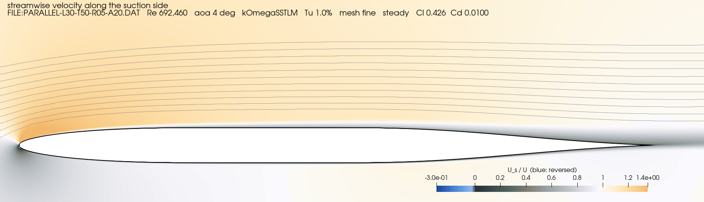

::::: {.callout-note appearance="simple" icon=false}
::: {.status}
**First version, 25 October 2026.** Every result here comes from 2D simulations of the board's
section, none from a real board. Whether the class allows a different section shape at all is
not known (@sec-question): check with a class measurer before building one.
:::
:::::

::: {.key-results}
::: {}
[NACA 0006, 1 in]{.big-number} 
the recommended section: the 4-digit section scaled to the class maximum, 5.56\ % of the 18 in chord
(confidence: high upwind in calm water, medium overall)
:::
::: {}
[+9 to +11\ %]{.big-number} 
more upwind board drag for NACA 63-006 and 64-006 at the calibrated Tu 0.3\ %; +2 to +3\ % at
Tu 0.6\ %
:::
::: {}
[5 of 6]{.big-number} 
turbulence and rake cases (Tu 0.3 and 0.6\ %, rake 5°, 10° and 15°) where NACA 0006 wins by the
agreed rule
:::
::: {}
[+4 to +63\ %]{.big-number} 
more upwind drag for the two parallel-sided boards, at both turbulence levels of the screen
:::
:::

[**Jump to:** [the answer](#sec-conclusion) · [the board](#sec-board) · [the sections](#sec-sections) ·
[how it was found](#sec-method) · [the results](#sec-results) · [the flow](#sec-flow)]{.jump-links}

## The question {#sec-question}

The Thistle is a 17 ft (5.2 m) one-design dinghy. Its centreboard has an 18 in (457 mm) chord. It
hangs from rollers on top of the trunk, at whatever angle it naturally takes, and reaches about
4 ft below the hull (an estimate from the class's draft). Which section shape gives it the least drag?

The class rules [@tca-rules-2026] set two limits that matter here:

* **Thickness.** A board may be at most **1 in** thick overall (Article XII.5): 5.56\ % of the chord.
  Every section on this page is exactly 1 in thick.
* **Shape.** Every board "must meet the dimensions and shape as shown on the Official Plans"
  (XII.2). The plans are not online, so whether they fix the section is not known. **Check with a
  class measurer before building a board.**

The board stays fully down on every leg. Upwind runs from 0 to 5 knots of boat speed, downwind up
to 15 knots. No published section for the Thistle's board was found, so the reference is
**NACA 0006 scaled to 1 in**, the simplest standard section of that thickness.

**The rule for ranking**, agreed before the simulations:

1. **Upwind first:** the board's drag at the same side force, over the upwind speeds.
2. **Stall margin:** a section must keep at least 2° between the high upwind load and its
   maximum side force, and not be more than 1° worse than NACA 0006.
3. **Downwind as tie-break or veto:** within ±1\ % upwind, the downwind drag decides. A section that
   loses more downwind than it gains upwind is vetoed.

## The board and the flow {#sec-board}

{#fig-board}

**The rake.** How far the board rakes when fully down is not published anywhere that was found. The
rules forbid making it hang more upright than it naturally does (XII.9). This study assumes **10°**
and checks 5° and 15°.

**Which chord does the water see?** The 18 in chord is measured square to the leading edge.
Measured along the flow it is longer: 18.07, 18.28 and 18.63 in at 5°, 10° and 15° of rake, through a
section a little thinner than 5.56\ %. This study works the other way round, with **simple sweep
theory**: it simulates the board's own section, 18 in and 5.56\ %, in a flow of speed
$V_n = V_b \cos Λ$, and maps the forces back to the whole board:

$$
S_h = C_l\, q \cos^2\!Λ\; c\, b
$$

$$
D_v = \left(C_{d,p} \cos^3\!Λ + C_{d,f} \cos Λ\right) q\, c\, b
$$

$$
D_i = \frac{S_h^2}{2\pi\, q\, e\, (b \cos Λ)^2}
$$

with $q = \tfrac12 \rho V_b^2$, $c$ the 18 in chord, $b$ = 1.24 m of board along the leading edge
(assumed) and $e$ = 0.9 (assumed, with the hull acting as a mirror). $S_h$ is the board's side force
and $D_h = D_v + D_i$ its drag. Every simulated point is used again for any rake; @sec-rake shows
how much the rake moves the comparison.

**The loads.** Sections are compared at the same side force, not the same angle, because the crew
needs a given side force whatever the board's shape. The light, working and high loads are the side
forces NACA 0006 makes at 1°, 2° and 4° at each boat speed: at 5 knots about 200-220, 400-440 and
790 N. The working load matches a rough estimate from the crew's righting moment, about 440 N at
5 knots (an estimate, methodology-thistle.md §3). The upwind score is the mean over 1-5 knots and the three
loads, all weighted equally, because there are no wind statistics for Thistle racing.

**No race time.** The [IOM pages](../custom-section/) turn drag and leeway into race time with the
boat's resistance curve. There is no such curve for the Thistle, so drag and leeway are reported
separately here.

{#fig-grid}

At 230,000 to 3.5 million the Reynolds number is 3 to 30 times higher than on an IOM fin. The
boundary layer can stay laminar over much of a smooth section, and where it turns turbulent decides
most of the drag.

## The sections {#sec-sections}

{#fig-sections}

[Scroll the table sideways →]{.table-hint}

::: {#tbl-properties}


The eight sections at 1 in on 18 in. Positions are from the leading edge; nose radius and
trailing-edge angle from the coordinates.
:::

* **NACA 0006** is the reference: the NACA 4-digit section, thickest at 30\ % of the chord.
* **NACA 63-006 and 64-006** are laminar-flow sections from NACA Report 824 [@abbott1945]. They are
  thickest further back, so the water keeps speeding up for longer and the boundary layer stays
  laminar for longer, at least near zero lift. Their noses are sharper. The study fitted smooth
  shapes to the report's tables with the nose radius held, and scaled them from 6\ % to 5.56\ %.
* **NACA 0006-64** is NACA 0006 with its crest moved back to 40\ %: a smaller step the same way.
* **HT35** is Mark Drela's glider tail section, the [IOM fin study's](../custom-section/) winner, and
  **SD8020** a sharp-nosed low-speed section; both from the UIUC database [@uiuc-coords].
* **The two parallel-sided boards** are flat in the middle, as many home-built boards are. The
  **plank** is the assumed typical one: half-round nose, flat from 10\ % to 75\ % of the chord, and a
  straight taper. **parallel-l30-t50** is the best of 144 parallel-sided shapes in XFOIL, from the
  family of Saporito et al. [-@saporito2020]: long tapers and a flat only from 30\ % to 50\ %.

::: {.callout-note collapse="true"}
## The XFOIL screen, selected sections (click to open)

[Scroll the table sideways →]{.table-hint}

::: {#tbl-xfoil}


XFOIL [@drela1989] estimates of board drag against NACA 0006, %, rake 10°. Upwind: the mean over
1-5 knots and the three loads; downwind: 0° over 1-15 knots. "Tripped": transition forced at 5\ % of
the chord. XFOIL's turbulence is set through Ncrit (Mack's correlation). Negative = less drag. The
last column marks the eight sections that went on to the CFD. The parallel-sided row is the best of
the 144-shape family (no Tu 0.5\ % run).
:::

XFOIL under-predicts the drag of these sections at Re 3 million by 2-25\ % against Report 824, and
its maximum lift for them is unusable (0.26-1.08 depending on Ncrit, against 0.83 measured). So it
only chose which sections to simulate. Two things it showed that the CFD did not test: a 7/8 in NACA
0006 is about level upwind at Tu 1\ % and 3-5\ % better downwind, and a 3/4 in one loses upwind in
calm water. Thinner boards were outside the agreed scope.
:::

## How the answer was found {#sec-method}

{#fig-pipeline}

### The simulations

The CFD is the project's 2D section model (`foil2d`): OpenFOAM [@openfoam], a steady solver,
and the k-ω SST turbulence model [@menter1994] with the Langtry-Menter transition model
[@langtry2009], which predicts where the boundary layer turns from laminar to turbulent. The
section sits in a C-shaped mesh 50 chords across, with the first cell at the wall thin enough to
resolve the laminar boundary layer ($y^+$ at most 2).

{#fig-mesh}

**Which mesh.** Three sections on four meshes, 96 cases. The fine mesh is within 2-3\ % of the extra
fine one in drag at most points, and up to about 7\ % where the transition sits mid-chord at the
working load. Medium is 4-23\ % off. So **differences under about 3\ % between sections are not
resolved**.

{#fig-mesh-study}

### Checked against wind-tunnel data

NACA Report 824 [@abbott1945] measured NACA 0006 and 64-006 at Re 3 million in a low-turbulence wind
tunnel: Reynolds numbers the Thistle's board reaches at about 13 knots. Both true 6\ % sections were
simulated at those conditions, 28 cases.

{#fig-validation}

* **Lift is right below stall,** within about 0.03 in $C_l$ up to 6° for both sections and models.
* **At the tunnel's turbulence the model is too laminar at low lift:** its drag is 23-40\ % low at
  $C_l$ 0-0.2, and it keeps a laminar low-drag range on 64-006 at $C_l$ 0.2 that the measurements
  don't show. At $C_l$ 0.45-0.65 it is within 2\ %.
* **Fully turbulent is too draggy** at low lift, by 18-90\ %.
* **64-006 stalls early in the model:** maximum $C_l$ about 0.64 against 0.83 measured. NACA 0006,
  with its rounder nose, is right to 8°.

### Calibrating the turbulence

The transition model reads the water's turbulence as one number, the inlet turbulence intensity
Tu. Which value makes it reproduce the quiet tunnel? 40 more cases swept Tu from 0.15 to 1.5\ % on
the same two sections at 0-4°.

{#fig-calibration}

* **NACA 0006 matches at Tu 0.3\ %,** within ±6\ % at 0-4°. **64-006 matches at about 0.45\ %.**
* So at any one Tu the model gives 64-006 10-20\ % less drag, relative to its measurement, than it
  gives NACA 0006 at low lift: **the model favours the 6-series** by about that much.
* **Tu 1\ % and above is effectively fully turbulent:** the drag at 1 and 1.5\ % is the same.

**What the number means.** Report 824's tunnel had a turbulence of a few hundredths of a percent; the
0.3-0.6\ % is what *this model* needs to reproduce it. A lake adds real turbulence on top: the
project's literature notes estimate about 0.1-0.3\ % at 4-15 knots and more at 1-2 knots, from
measured near-surface turbulence [@remmlinger2013, not peer reviewed; an estimate]. Saporito et al. [-@saporito2020] used 0.6\ % to match the
same 64-006 data with a different transition model. So **Tu 0.3-0.6\ % is taken as calm water**
and Tu 1\ % as a rough-water bound. The literature notes are in the repository
(docs/research/turbulence-intensity.md).

### Two stages of CFD

* **The screen:** all eight sections at the 20 points that can reject one (1, 3 and 5 knots at 0-8°,
  15 knots at 0° and 2°), at Tu 0.1 and 1\ %, which bracket the calibrated band: 320 cases. A section
  is rejected only if it loses at both levels.
* **The finalists:** the survivors over all 57 points at Tu 0.3 and 0.6\ %: 342 cases. They decide
  the ranking.

## Results {#sec-results}

Click any chart to see it larger.

### The screen: eight sections {#sec-screen}

{#fig-screen}

{#fig-tradeoff}

[Scroll the table sideways →]{.table-hint}

::: {#tbl-screen}


Board drag against NACA 0006, %, rake 10° (negative = less drag); stall margin in degrees past the
high load, on a 2° grid. Upwind 1, 3 and 5 knots; downwind 1, 3, 5 and 15 knots.
:::

* **The two parallel-sided boards lose at both levels** and are rejected. The plank has 35-63\ % more
  drag upwind and 45-76\ % more downwind. The best parallel-sided board has 4-14\ % more upwind; it
  loses 12\ % downwind in calm water and breaks even at Tu 1\ %. Every step towards a foil helps, as
  Saporito et al. [-@saporito2020] found: a parallel-sided board at best matches a NACA section.
* **HT35 and SD8020 match NACA 0006** within the mesh uncertainty at both levels, never ahead by
  more. NACA 0006-64 trades less than the 6-series. These three were dropped.
* **The two levels disagree about the 6-series:** 10-12\ % behind upwind at Tu 0.1\ %, level at
  Tu 1\ %, where they are 10-11\ % ahead downwind. So NACA 0006, 63-006 and 64-006 went on to the
  finalists.

### The finalists at the calibrated turbulence {#sec-finalists}

[Scroll the table sideways →]{.table-hint}

::: {#tbl-results}


The finalists against NACA 0006, rake 10°: board drag $D_h$ at equal side force, %. Upwind is the
mean over 1-5 knots and the three loads; "worst" is the least favourable of those 15 points. Stall
margin: the smallest over the speeds, degrees past the high load.
:::

* **NACA 0006 has the least drag upwind at both levels.** At Tu 0.3\ % it is ahead at 13 and 14 of
  the 15 speed and load points; at Tu 0.6\ % at 8 and 9 of 15.
* **The 6-series lose at the working and high loads** (+10 to +16\ %), and gain only at the light
  load, where the side force is smallest. At Tu 0.6\ % they are ahead at 4-5 knots.
* **Downwind they have 5-8\ % less drag,** but almost all of it at high speed: from 10 knots at
  Tu 0.3\ %, from 7.5 knots at 0.6\ %. At 4-5 knots they have more.
* **No stall veto applies:** every section reaches its maximum side force at least 3.9° past the high
  load. Those maxima rest on unsteady, unconverged points at 8-10°, so the margins are indicative.

{#fig-finalists}

{#fig-equal-force}

### How much turbulence decides it {#sec-turbulence}

{#fig-bounds}

The upwind gap closes steadily as the water gets more turbulent: 10-12\ % at Tu 0.1\ %, 8-9\ % at
0.3\ %, 1-2\ % at 0.6\ % and level at 1\ % (on the screen's 1, 3 and 5 knots). NACA 0006 keeps its
laminar boundary layer at moderate lift only while the water is calm. Once it loses it, its rounder
nose no longer pays, and the 6-series' longer laminar run at low lift gives them the edge downwind.

### The rake {#sec-rake}

[Scroll the table sideways →]{.table-hint}

::: {#tbl-rake}


The finalists against NACA 0006 at rake 5°, 10° and 15°, %. The loads are held at the rake-10° values
in newtons.
:::

More rake widens NACA 0006's lead upwind: at a given side force the section must work at a higher
lift coefficient. Only at Tu 0.6\ % with 5° rake are the 6-series within 1\ % upwind, so downwind
decides there, for 64-006 (7.9\ % less drag). In the other 5 of the 6 cases NACA 0006 wins.

### Checking against the measurements {#sec-check}

Is NACA 0006's lead an artefact of the model? Two checks say no.

{#fig-r824}

1. **The measurements show the same trade.** At equal $C_l$, Report 824's 64-006 has 11\ % less drag
   than NACA 0006 at $C_l$ 0 and 8\ % less at 0.1, but 20\ % more at 0.2, 14\ % more at 0.3 and 8\ %
   more at 0.4. The upwind loads sit in the second range, downwind in the first. This is one
   Reynolds number, about 13 knots; upwind runs at a quarter to a third of it.
2. **Correcting for the model's bias doesn't change the upwind answer.** The calibration matched the
   tunnel with NACA 0006 at Tu 0.3\ % and 64-006 at about 0.45\ %. Compared at those inputs, 64-006
   is still about 11\ % behind upwind (10.6-11.3\ %), and about level downwind (−5 to +5\ %): the
   correction removes most of its downwind gain.

### Why NACA 0006 wins upwind {#sec-why}

{#fig-laminar}

* **At Tu 0.3\ %,** NACA 0006 keeps its suction side laminar to about 93\ % of the chord. The 6-series'
  sharper noses make a suction peak right at the leading edge; their boundary layer separates in a
  short bubble from about 74\ % and turns turbulent by 80\ %. Their drag at 2° is 7\ % higher, and
  they make 11\ % less lift there.
* **At Tu 0.6\ %,** NACA 0006 turns turbulent at about 55\ %, the 6-series at about 65\ %. Their drag at
  2° is now lower, but NACA 0006 makes 10\ % more lift at the same angle, so at the same side force it
  is still about 4\ % ahead at 3 knots.
* **Downwind, at 0°,** all three are laminar to 80-95\ % of the chord at 3 knots. The 6-series pull
  ahead only once NACA 0006 loses its own laminar run at higher speed (@fig-finalists).

The 6-series' lower lift at the same angle is a model result that Report 824 doesn't show (it
measured similar lift slopes for both sections). The measured drag at equal $C_l$
(@fig-r824) points the same way without it.

## The flow {#sec-flow}

The videos show NACA 0006, the best parallel-sided board and the plank at 3 knots and Tu 1\ %, the
screen's rough-water level, from 0° to 8°. Each frame is a separate steady solution, one per angle,
not a time history. The colours are those of the [IOM pages](../fin-selection/#sec-gallery): in the
first video pale is the free stream, dark the slow water near the wall and blue reversed flow; in
the second, speed from dark blue (slow) to red (fast).

::: {#fig-flow-sweep}


Streamwise velocity along the suction side, 0-8°: NACA 0006 (top), parallel-l30-t50 (middle) and
the plank (bottom), 3 knots, Tu 1\ %, steady. Each frame's title gives the angle, $C_l$ and $C_d$.
:::

::: {#fig-flow-sweep-velocity}


The same cases as flow speed and streamlines (the colour bar is cut off below 0.6 of the free-stream
speed).
:::

* **0-4°: all three attached.** The plank's blunt nose and straight taper leave a thicker wake: at
  0° it has 67\ % more drag than NACA 0006 ($C_d$ 0.0105 against 0.0063). At 4° it makes 15\ % less
  lift for about the same drag, so it needs more angle, and more drag, for the same side force.
* **6-8°: the parallel-sided board stalls first.** At 8° its flow is reversed from the nose to 80\ %
  of the chord ($C_l$ 0.63, $C_d$ 0.068). NACA 0006 has a long bubble behind the nose, to 22\ % of the
  chord ($C_l$ 0.71, $C_d$ 0.040). These two 8° solutions oscillate and did not converge.
* **The plank's one strength:** its half-round nose keeps the flow attached even at 8° ($C_l$ 0.73,
  $C_d$ 0.015). But the high upwind load is at 4°, and its drag there is what loses.
* **At this speed and turbulence the parallel-sided board is close to NACA 0006** below 6°: 1-2\ %
  more drag upwind, 13\ % less at 0°. It loses in calm water: at Tu 0.1\ % and 3 knots it has 6-31\ %
  more drag upwind and 23\ % more at 0°. And it stalls first.

::: {layout-ncol=1}
{#fig-flow-4-naca}

{#fig-flow-4-parallel}

{#fig-flow-4-plank}
:::

::: {layout-ncol=1}
{#fig-flow-8-naca}

{#fig-flow-8-parallel}

{#fig-flow-8-plank}
:::

## Conclusion {#sec-conclusion}

*Everything here comes from 2D simulations of the board's section, not from tests of a board.*

**Recommended: keep NACA 0006 at 1 in** (5.56\ % of the 18 in chord). Accepted for the study on
25 October 2026.

* **Upwind it has the least drag of the sections tested** once the model is calibrated against
  wind-tunnel data: the 6-series have 9-11\ % more at Tu 0.3\ % and 2-3\ % more at 0.6\ %, mostly at the
  working and high loads. NACA's own measurements show the same trade.
* **It wins by the agreed rule in 5 of the 6 turbulence and rake cases.** The exception is Tu 0.6\ %
  with 5° rake, where 64-006 is 0.8\ % behind upwind and downwind decides for it.
* **Its stall margin is as good as any:** at least 4° past the high load.
* **Parallel-sided boards lose both ways.** A typical home-built plank has 35-63\ % more drag
  upwind. If a board is being rebuilt anyway, fairing it to a foil section is worth more than the
  choice between foil sections.

**When a 6-series board might pay.** In rough water, where Tu is about 1\ %, NACA 63-006 and 64-006
are level upwind and 10-11\ % better downwind. And a sailor who cares more about the legs above
7.5 knots than about upwind gets 10-17\ % less drag there for 2-11\ % more upwind. Neither was the
agreed priority.

**Confidence: high that no section tested beats NACA 0006 upwind in calm water; medium overall.**
Why not higher:

* **The model.** The transition model was calibrated at one Reynolds number (3 million) on two
  sections; 63-006 was not calibrated. Between sections its error differs by 10-20\ %, which is the
  size of the downwind differences.
* **The water.** The answer turns on the water's turbulence, which nobody has measured for a lake in
  the model's terms. The calibrated 0.3-0.6\ % is a lower bound.
* **The steady solver.** About a third of NACA 0006's points near 0-3° oscillate a little (drag
  varying by 2-8\ %). Its lead at the light load is within that; at the working and high loads it is
  not. All 8-10° points are unsteady, so the stall margins are indicative.
* **Assumed geometry.** The rake (10°, checked 5-15°), the 1.24 m of board below the hull and the
  span efficiency are assumptions, and 2D leaves out the tip, the hull junction and the board's
  planform.
* **Gaps in the grid.** No speeds between 5 and 7.5 knots, where NACA 0006's drag at 0° jumps as its
  laminar run is lost.

**What would change it:**

* the Official Plans fixing the section, which would settle it;
* a measurement of turbulence in the water a Thistle sails, or a towing test of two boards;
* a section designed for 1 in at these Reynolds numbers (an optimisation was set up, but its gain
  would likely be a few per cent, within the model's error, so it was not run; an estimate);
* 3D simulations of the whole board under the hull.

## How the work went {#sec-studies}

Each study has a dated entry in the
[findings log](https://github.com/kmamykin/iom_cfd/blob/main/projects/foil2d/findings/thistle-board.md).

::: {.callout-note collapse="true"}
## The studies, one by one (click to open)

::: {#tbl-studies}
| when | study | question | answer |
|:----|:----------------|:----------------|:------------------------|
| 22-23\ Oct | set-up | What do the rules allow, and what chord does the water see? | At most 1 in thick; the shape may be fixed by the Official Plans. No published rake: 10° assumed, 5-15° checked; simple sweep theory. |
| 23\ Oct | XFOIL screen: 26 sections, 144 parallel-sided shapes | Which sections are worth simulating? | Eight, from NACA 0006 to a typical plank. The 6-series trade upwind for downwind; parallel-sided boards lose. |
| 23\ Oct | mesh study: 96 cases | Which mesh? | Fine: within 2-3\ % of extra fine at most points. Differences under 3\ % are not resolved. |
| 23\ Oct | validation against Report 824: 28 cases | Does the model match NACA's wind-tunnel data? | Lift yes; drag too low at low lift at the tunnel's turbulence, too high fully turbulent. 64-006 stalls early in the model. |
| 24\ Oct | Tu calibration: 40 cases | Which turbulence input reproduces the tunnel? | 0.3\ % for NACA 0006, about 0.45\ % for 64-006: the model favours the 6-series by 10-20\ %. |
| 23-24\ Oct | CFD screen: 8 sections, 320 cases (312 finished) | Which sections can be rejected? | Both parallel-sided boards. HT35, SD8020 and 0006-64 dropped. The 6-series go on. |
| 24-25\ Oct | finalists: 3 sections, 342 cases | Which wins at the calibrated turbulence? | NACA 0006 upwind at Tu 0.3 and 0.6\ %; the 6-series 5-8\ % better downwind. |
| 25\ Oct | decision | | NACA 0006 at 1 in, accepted. |

The studies.
:::
:::

## Reproducing this {.appendix .unnumbered}

Everything is in [the repository](https://github.com/kmamykin/iom_cfd): the simulation setup
(`projects/foil2d/`), every study file (`thistle-*.yaml`), the board's inputs
(`projects/foil2d/design/thistle.yaml`), the section coordinates (`geometry/foils/`), the ranking code
(`src/iomcfd/boardrank.py`), the method (`projects/foil2d/methodology-thistle.md`) and the findings
log with the numbers behind each conclusion. This page's charts are drawn from the small data files
below, which `iomcfd site export` copies out of the runs; the rankings are computed from them with the
same code (`boardrank.rank`) that produced the findings. The flow pictures are ParaView renders
(`iomcfd viz`) of the 18 cases fetched whole; the videos stack them with `tools/stack_viz_video.py`.
The code is under the [MIT licence](https://github.com/kmamykin/iom_cfd/blob/main/LICENSE); the text,
figures and data on this page are under CC BY 4.0. The HT35 and SD8020 coordinates come from the UIUC
Airfoil Coordinates Database, which states no licence for them; the Report 824 data were digitised
from the report.

## Data behind the figures {.appendix .unnumbered}



## Revision history {.appendix .unnumbered}

* **25 October 2026.** First version: the XFOIL screen, the mesh study, the validation against
  Report 824, the turbulence calibration, the CFD screen of eight sections and the finalists at
  Tu 0.3 and 0.6\ %; flow pictures of NACA 0006, parallel-l30-t50 and the plank.
